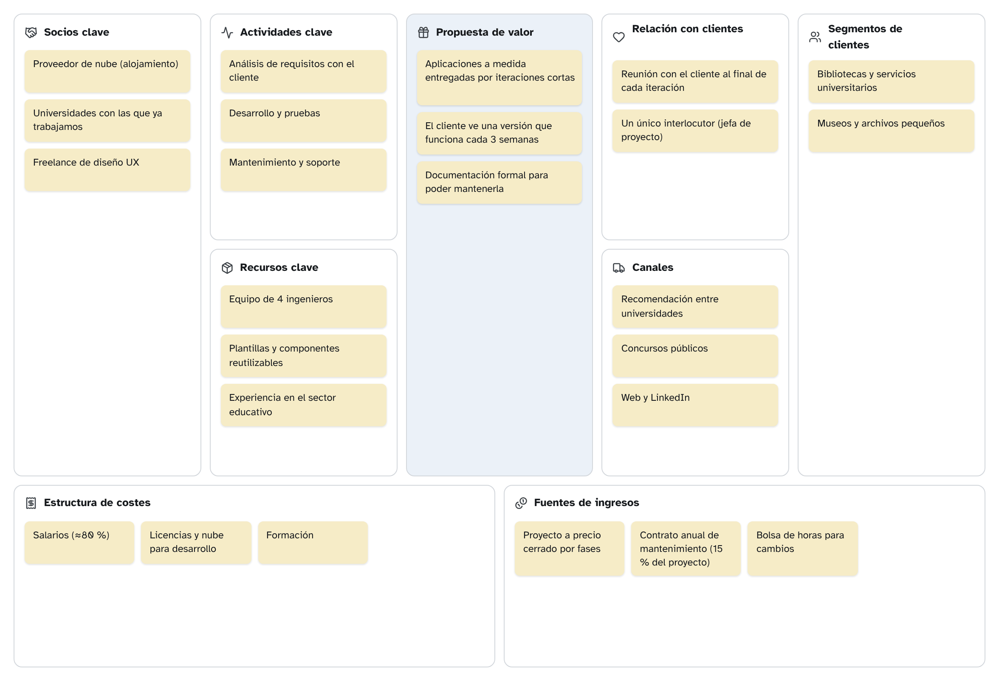
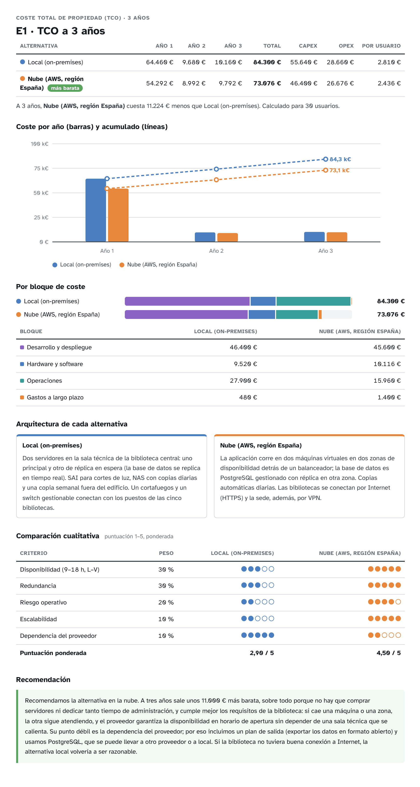

# Ejemplo — BiblioYa — Entrega 1 — Empresa y TCO

_Exportado con se-ramify el 20/10/2026._

## Contenido de la entrega

| Apartado | Peso | Diagramas |
|---|---|---|
| Definición de la empresa: nombre, marca, modelo de negocio y roles | 25 % | E1 · Modelo de negocio — Faro Software; E1 · Organigrama y roles; _Nombre y marca (logo, lema) (texto)_ |
| Descripción completa de las dos alternativas, con su arquitectura | 25 % | E1 · Arquitectura — local; E1 · Arquitectura — nube |
| TCO a 3 años con costes completos y realistas de cada alternativa | 25 % | E1 · TCO a 3 años |
| Recomendación razonada de la alternativa más adecuada | 25 % | E1 · TCO a 3 años |

## Índice

1. [E1 · Modelo de negocio — Faro Software](#1-e1-modelo-de-negocio-faro-software) — Lienzo de modelo de negocio
2. [E1 · Organigrama y roles](#2-e1-organigrama-y-roles) — Organigrama y roles
3. [E1 · Arquitectura — local](#3-e1-arquitectura-local) — Diagrama de arquitectura / equipos
4. [E1 · Arquitectura — nube](#4-e1-arquitectura-nube) — Diagrama de arquitectura / equipos
5. [E1 · TCO a 3 años](#5-e1-tco-a-3-anos) — TCO (coste total de propiedad)

## 1. E1 · Modelo de negocio — Faro Software

*Lienzo de modelo de negocio*

Faro Software es una empresa inventada de cuatro personas. Este lienzo describe la empresa, no el producto.

**Negocio:** Faro Software — software a medida para instituciones educativas y culturales

### Socios clave

- Proveedor de nube (alojamiento)
- Universidades con las que ya trabajamos
- Freelance de diseño UX

### Actividades clave

- Análisis de requisitos con el cliente
- Desarrollo y pruebas
- Mantenimiento y soporte

### Recursos clave

- Equipo de 4 ingenieros
- Plantillas y componentes reutilizables
- Experiencia en el sector educativo

### Propuesta de valor

- Aplicaciones a medida entregadas por iteraciones cortas
- El cliente ve una versión que funciona cada 3 semanas
- Documentación formal para poder mantenerla

### Relación con clientes

- Reunión con el cliente al final de cada iteración
- Un único interlocutor (jefa de proyecto)

### Canales

- Recomendación entre universidades
- Concursos públicos
- Web y LinkedIn

### Segmentos de clientes

- Bibliotecas y servicios universitarios
- Museos y archivos pequeños

### Estructura de costes

- Salarios (≈80 %)
- Licencias y nube para desarrollo
- Formación

### Fuentes de ingresos

- Proyecto a precio cerrado por fases
- Contrato anual de mantenimiento (15 % del proyecto)
- Bolsa de horas para cambios

### Notas

Faro Software es una empresa inventada de cuatro personas. Este lienzo describe la empresa, no el producto.

## 2. E1 · Organigrama y roles

*Organigrama y roles*

| Rol | Persona | Área | Depende de | Responsabilidades |
|---|---|---|---|---|
| Dirección y jefatura de proyecto | Ana López |  | — | Planifica y sigue el proyecto (Gantt) Interlocutora con el cliente Redacta las actas |
| Análisis y requisitos | Bruno Díaz | Equipo de desarrollo | Dirección y jefatura de proyecto | Casos de uso y especificaciones Historias de usuario y Gherkin |
| Arquitectura y diseño | Carla Gómez | Equipo de desarrollo | Dirección y jefatura de proyecto | Diagramas de clases y secuencia Arquitectura y TCO |
| Desarrollo y calidad | David Martín | Equipo de desarrollo | Dirección y jefatura de proyecto | Implementación Plan y casos de prueba |

## 3. E1 · Arquitectura — local

*Diagrama de arquitectura / equipos*

Alternativa A. Todo duplicado donde una avería pararía el servicio: dos servidores con réplica, dos switches, SAI y copias en NAS.

### Sala técnica de la biblioteca

| Equipo | Tipo |
|---|---|
| Router + firewall | Cortafuegos |
| SAI | SAI |
| Switch principal ×2 | Switch |
| Servidor 1 (app + BD) | Servidor |
| Servidor 2 (réplica) | Servidor |
| NAS de copias | NAS / copias |

### Mostradores y despachos

| Equipo | Tipo |
|---|---|
| Switch de planta | Switch |
| Lectores de carné ×4 | TPV |
| PC mostrador ×4 | PC de sobremesa |
| Portátiles gestión ×2 | Portátil |

### Fuera de zonas

| Equipo | Tipo |
|---|---|
| Socios (móvil) | Móvil |

### Conexiones

- Router + firewall → Switch principal ×2
- SAI → Servidor 1 (app + BD) (corriente)
- Switch principal ×2 → Servidor 1 (app + BD)
- Switch principal ×2 → Servidor 2 (réplica)
- Switch principal ×2 → NAS de copias
- Servidor 1 (app + BD) → Servidor 2 (réplica) (réplica)
- Switch principal ×2 → Switch de planta
- Switch de planta → PC mostrador ×4
- Switch de planta → Portátiles gestión ×2
- Lectores de carné ×4 → PC mostrador ×4 (USB)
- Socios (móvil) → Router + firewall (Internet (HTTPS))

## 4. E1 · Arquitectura — nube

*Diagrama de arquitectura / equipos*

Alternativa B. La aplicación en dos zonas de disponibilidad detrás de un balanceador, con base de datos gestionada multi-AZ.

### Biblioteca

| Equipo | Tipo |
|---|---|
| Router + firewall | Cortafuegos |
| Switch | Switch |
| PC mostrador ×4 | PC de sobremesa |
| Portátiles gestión ×2 | Portátil |

### Nube (región eu-south-2, Madrid)

| Equipo | Tipo |
|---|---|
| Balanceador de carga | Switch |
| VM app — zona A | Servicio en la nube |
| VM app — zona B | Servicio en la nube |
| BD gestionada (multi-AZ) | Base de datos |
| Copias (almacenamiento) | NAS / copias |

### Fuera de zonas

| Equipo | Tipo |
|---|---|
| Socios (móvil) | Móvil |

### Conexiones

- Router + firewall → Balanceador de carga (Internet (HTTPS))
- Switch → Router + firewall
- PC mostrador ×4 → Switch
- Portátiles gestión ×2 → Switch
- Balanceador de carga → VM app — zona A
- Balanceador de carga → VM app — zona B
- VM app — zona A → BD gestionada (multi-AZ)
- VM app — zona B → BD gestionada (multi-AZ)
- BD gestionada (multi-AZ) → Copias (almacenamiento) (copia diaria)
- Socios (móvil) → Balanceador de carga (4G / Wi-Fi)

## 5. E1 · TCO a 3 años

*TCO (coste total de propiedad)*

_Coste total de propiedad a 3 años, sin inflación ni tasa de descuento. Importes en euros._

### Local (on-premises)

Dos servidores en la sala técnica de la biblioteca central: uno principal y otro de réplica en espera (la base de datos se replica en tiempo real). SAI para cortes de luz, NAS con copias diarias y una copia semanal fuera del edificio. Un cortafuegos y un switch gestionable conectan con los puestos de las cinco bibliotecas.

| Bloque | Concepto | Tipo | Pago | Año 1 | Año 2 | Año 3 | Total | Fuente |
|---|---|---|---|---:|---:|---:|---:|---|
| Desarrollo | Análisis, desarrollo y pruebas (horas del equipo, 35 €/h) (×1200) | CAPEX | Una vez (año 1) | 42.000 € | 0 € | 0 € | **42.000 €** | ejemplo — horas estimadas × coste/hora |
| Desarrollo | Instalación, configuración y migración de datos | CAPEX | Una vez (año 1) | 3.200 € | 0 € | 0 € | **3.200 €** | ejemplo — sustituir por precio real |
| Desarrollo | Formación del personal de las bibliotecas | CAPEX | Una vez (año 1) | 1.200 € | 0 € | 0 € | **1.200 €** | ejemplo — sustituir por precio real |
| HW y SW | Servidor Dell PowerEdge T150 (Xeon E-2314, 32 GB, 2× SSD 960 GB) (×2) | CAPEX | Una vez (año 1) | 3.300 € | 0 € | 0 € | **3.300 €** | ejemplo — sustituir por precio real |
| HW y SW | SAI APC Smart-UPS 1500 VA | CAPEX | Una vez (año 1) | 780 € | 0 € | 0 € | **780 €** | ejemplo — sustituir por precio real |
| HW y SW | NAS Synology DS923+ | CAPEX | Una vez (año 1) | 620 € | 0 € | 0 € | **620 €** | ejemplo — sustituir por precio real |
| HW y SW | Discos para el NAS (4 TB) (×4) | CAPEX | Una vez (año 1) | 480 € | 0 € | 0 € | **480 €** | ejemplo — sustituir por precio real |
| HW y SW | Switch gestionable 24 puertos | CAPEX | Una vez (año 1) | 280 € | 0 € | 0 € | **280 €** | ejemplo — sustituir por precio real |
| HW y SW | Cortafuegos FortiGate 40F | CAPEX | Una vez (año 1) | 650 € | 0 € | 0 € | **650 €** | ejemplo — sustituir por precio real |
| HW y SW | Armario rack 12U | CAPEX | Una vez (año 1) | 350 € | 0 € | 0 € | **350 €** | ejemplo — sustituir por precio real |
| HW y SW | Windows Server 2025 Standard (16 núcleos) (×2) | CAPEX | Una vez (año 1) | 2.300 € | 0 € | 0 € | **2.300 €** | ejemplo — sustituir por precio real |
| HW y SW | Ampliación de garantía del fabricante (×2) | OPEX | Al año desde el año 2 | 0 € | 380 € | 380 € | **760 €** | ejemplo — sustituir por precio real |
| Operaciones | Administrador de sistemas (20 % de 38.000 €/año) | OPEX | Al año | 7.600 € | 7.600 € | 7.600 € | **22.800 €** | ejemplo — tabla salarial |
| Operaciones | Copia externa en la nube (2 TB) | OPEX | Al mes | 300 € | 300 € | 300 € | **900 €** | ejemplo — sustituir por precio real |
| Operaciones | Mantenimiento correctivo y parches (40 h/año) | OPEX | Al año | 1.400 € | 1.400 € | 1.400 € | **4.200 €** | ejemplo — sustituir por precio real |
| Largo plazo | Reemplazo de discos del NAS (×4) | CAPEX | Una vez (año 3) | 0 € | 0 € | 480 € | **480 €** | ejemplo — sustituir por precio real |
| | **Total** | | | **64.460 €** | **9.680 €** | **10.160 €** | **84.300 €** | |

### Nube (AWS, región España)

La aplicación corre en dos máquinas virtuales en dos zonas de disponibilidad detrás de un balanceador; la base de datos es PostgreSQL gestionado con réplica en otra zona. Copias automáticas diarias. Las bibliotecas se conectan por Internet (HTTPS) y la sede, además, por VPN.

| Bloque | Concepto | Tipo | Pago | Año 1 | Año 2 | Año 3 | Total | Fuente |
|---|---|---|---|---:|---:|---:|---:|---|
| Desarrollo | Análisis, desarrollo y pruebas (horas del equipo, 35 €/h) (×1200) | CAPEX | Una vez (año 1) | 42.000 € | 0 € | 0 € | **42.000 €** | ejemplo — horas estimadas × coste/hora |
| Desarrollo | Migración de datos y puesta en marcha en la nube | CAPEX | Una vez (año 1) | 2.400 € | 0 € | 0 € | **2.400 €** | ejemplo — sustituir por precio real |
| Desarrollo | Formación del personal de las bibliotecas | CAPEX | Una vez (año 1) | 1.200 € | 0 € | 0 € | **1.200 €** | ejemplo — sustituir por precio real |
| HW y SW | Máquinas virtuales EC2 t3.medium (una por zona) (×2) | OPEX | Al mes | 840 € | 840 € | 840 € | **2.520 €** | ejemplo — calculadora de AWS |
| HW y SW | Base de datos RDS PostgreSQL db.t3.medium multi-AZ | OPEX | Al mes | 1.680 € | 1.680 € | 1.680 € | **5.040 €** | ejemplo — calculadora de AWS |
| HW y SW | Balanceador de carga (ALB) | OPEX | Al mes | 264 € | 264 € | 264 € | **792 €** | ejemplo — calculadora de AWS |
| HW y SW | Almacenamiento de copias (S3, 300 GB) | OPEX | Al mes | 96 € | 96 € | 96 € | **288 €** | ejemplo — calculadora de AWS |
| HW y SW | Tráfico de salida | OPEX | Al mes | 60 € | 60 € | 60 € | **180 €** | ejemplo — calculadora de AWS |
| HW y SW | VPN sitio a sitio con la biblioteca central | OPEX | Al mes | 432 € | 432 € | 432 € | **1.296 €** | ejemplo — calculadora de AWS |
| Operaciones | Plan de soporte Business | OPEX | Al mes | 1.200 € | 1.200 € | 1.200 € | **3.600 €** | ejemplo — web del proveedor |
| Operaciones | Administrador cloud (10 % de 40.000 €/año) | OPEX | Al año | 4.000 € | 4.000 € | 4.000 € | **12.000 €** | ejemplo — tabla salarial |
| Operaciones | Monitorización y alertas | OPEX | Al mes | 120 € | 120 € | 120 € | **360 €** | ejemplo — calculadora de AWS |
| Largo plazo | Crecimiento de uso (más socios y préstamos) | OPEX | Al año desde el año 2 | 0 € | 300 € | 300 € | **600 €** | ejemplo — sustituir por precio real |
| Largo plazo | Plan de salida: exportar datos si se cambia de proveedor | CAPEX | Una vez (año 3) | 0 € | 0 € | 800 € | **800 €** | ejemplo — sustituir por precio real |
| | **Total** | | | **54.292 €** | **8.992 €** | **9.792 €** | **73.076 €** | |

### Resumen

| Alternativa | Año 1 | Año 2 | Año 3 | Total 3 años | CAPEX | OPEX | Por usuario |
|---|---:|---:|---:|---:|---:|---:|---:|
| Local (on-premises) | 64.460 € | 9.680 € | 10.160 € | **84.300 €** | 55.640 € | 28.660 € | 2.810,00 € |
| Nube (AWS, región España) | 54.292 € | 8.992 € | 9.792 € | **73.076 €** | 46.400 € | 26.676 € | 2.435,87 € |

| Bloque | Local (on-premises) | Nube (AWS, región España) |
|---|---:|---:|
| Desarrollo y despliegue | 46.400 € | 45.600 € |
| Hardware y software | 9.520 € | 10.116 € |
| Operaciones | 27.900 € | 15.960 € |
| Gastos a largo plazo | 480 € | 1.400 € |

La alternativa más barata a 3 años es **Nube (AWS, región España)** (73.076 €), 11.224 € menos que Local (on-premises).

Calculado para 30 usuarios.

### Comparación cualitativa

_Puntuación de 1 (peor) a 5 (mejor), ponderada por el peso de cada criterio._

| Criterio | Peso | Local (on-premises) | Nube (AWS, región España) |
|---|---:|---:|---:|
| Disponibilidad (9–18 h, L–V) | 30 % | 3 | 5 |
| Redundancia | 30 % | 3 | 5 |
| Riesgo operativo | 20 % | 2 | 4 |
| Escalabilidad | 10 % | 2 | 5 |
| Dependencia del proveedor | 10 % | 5 | 2 |
| **Puntuación ponderada** | | **2,90** | **4,50** |

### Recomendación

Recomendamos la alternativa en la nube. A tres años sale unos 11.000 € más barata, sobre todo porque no hay que comprar servidores ni dedicar tanto tiempo de administración, y cumple mejor los requisitos de la biblioteca: si cae una máquina o una zona, la otra sigue atendiendo, y el proveedor garantiza la disponibilidad en horario de apertura sin depender de una sala técnica que se calienta. Su punto débil es la dependencia del proveedor; por eso incluimos un plan de salida (exportar los datos en formato abierto) y usamos PostgreSQL, que se puede llevar a otro proveedor o a local. Si la biblioteca no tuviera buena conexión a Internet, la alternativa local volvería a ser razonable.
