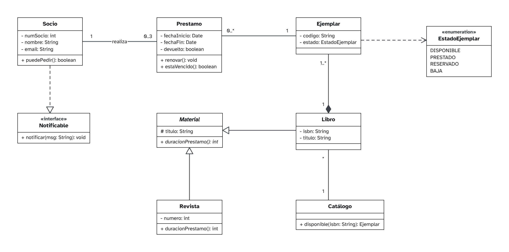
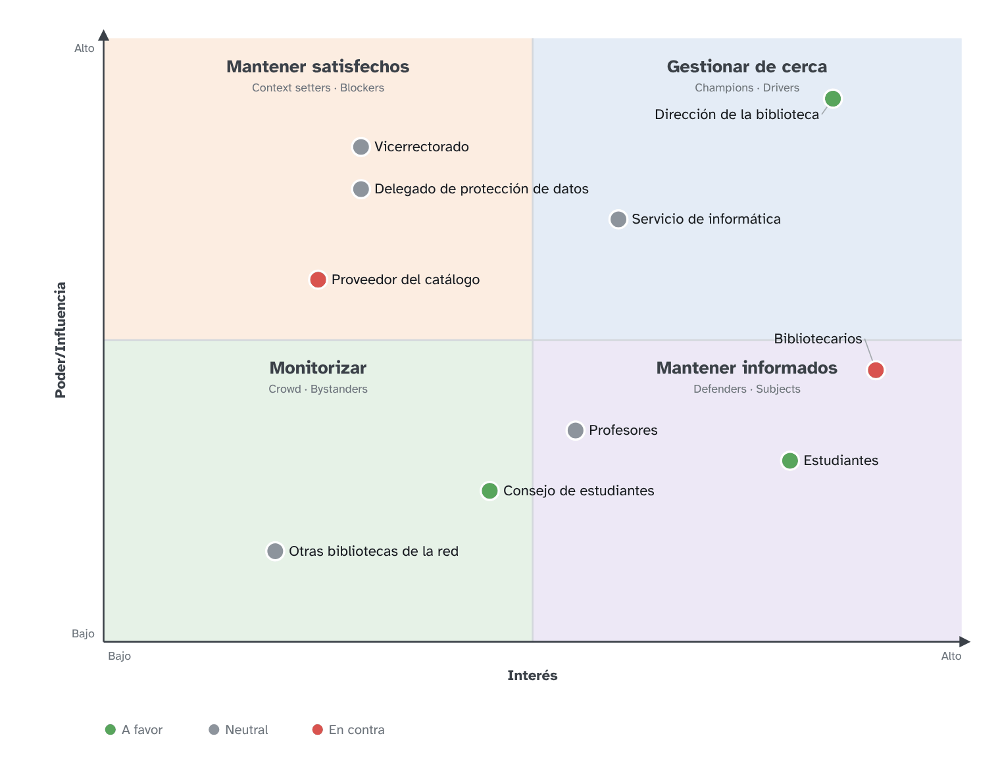
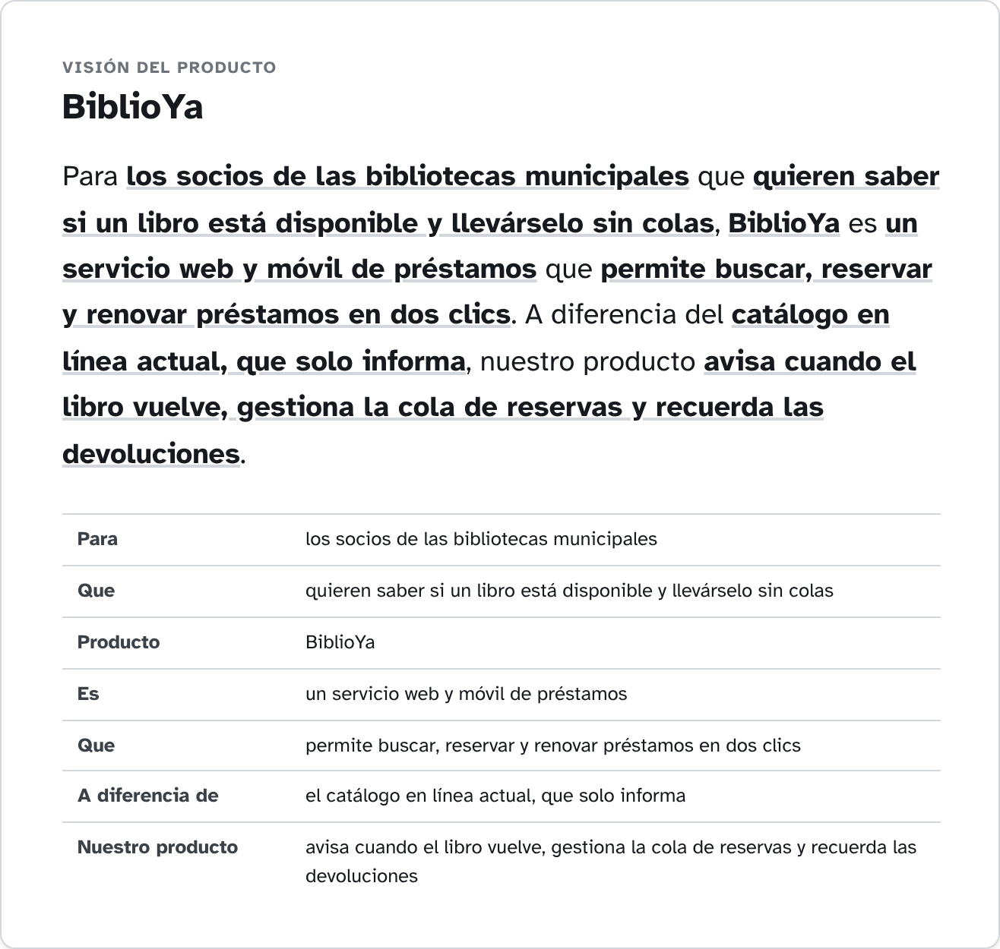

# Ejemplo — BiblioYa — Entrega 2 — UML, stakeholders y visión

_Exportado con se-ramify el 23/10/2026._

## Contenido de la entrega

| Apartado | Peso | Diagramas |
|---|---|---|
| Todos los diagramas UML: casos de uso con especificaciones, clases y secuencia | 60 % | E2 · Casos de uso; E2 · Diagrama de clases de diseño; E2 · Secuencia — Reservar libro |
| Mapa de stakeholders (uno de los dos formatos, mínimo seis) | 20 % | E2 · Mapa de stakeholders |
| Visión del proyecto según el modelo del "elevator pitch" | 20 % | E2 · Visión — elevator pitch |

## Índice

1. [E2 · Casos de uso](#1-e2-casos-de-uso) — Diagrama de sistema / casos de uso
2. [E2 · Diagrama de clases de diseño](#2-e2-diagrama-de-clases-de-diseno) — Diagrama de clases
3. [E2 · Secuencia — Reservar libro](#3-e2-secuencia-reservar-libro) — Diagrama de secuencia
4. [E2 · Mapa de stakeholders](#4-e2-mapa-de-stakeholders) — Mapa de stakeholders
5. [E2 · Visión — elevator pitch](#5-e2-vision-elevator-pitch) — Visión — elevator pitch

## 1. E2 · Casos de uso

*Diagrama de sistema / casos de uso*

### CU-01 Buscar libro

| Campo | Contenido |
|---|---|
| Código | CU-01 |
| Nombre | Buscar libro |
| Actor principal | Socio |
| Actores secundarios |  |
| Descripción | El socio busca libros del catálogo por título, autor o ISBN y ve si hay ejemplares disponibles. |
| Disparador | El socio escribe en el buscador. |
| Precondiciones | Ninguna (la búsqueda es pública). |
| Flujo principal | 1. El socio escribe un título, autor o ISBN. 2. El sistema muestra los libros que coinciden, con el número de ejemplares disponibles. 3. El socio abre la ficha de un libro. 4. El sistema muestra sus ejemplares y su estado. |
| Flujos alternativos | 2a. No hay resultados: el sistema lo indica y sugiere revisar la ortografía. |
| Postcondiciones | Ninguna (no cambia datos). |
| Prioridad | Alta |
| Frecuencia | Cientos de veces al día |

### CU-02 Reservar libro

| Campo | Contenido |
|---|---|
| Código | CU-02 |
| Nombre | Reservar libro |
| Actor principal | Socio |
| Actores secundarios |  |
| Descripción | El socio reserva un libro que ahora está prestado para recogerlo cuando se devuelva. |
| Disparador | El socio pulsa «Reservar» en la ficha de un libro. |
| Precondiciones | El socio ha iniciado sesión y no tiene sanciones. |
| Flujo principal | 1. El socio busca el libro (CU-01). 2. El sistema muestra la ficha con sus ejemplares. 3. El socio pulsa «Reservar». 4. El sistema registra la reserva y muestra la posición en la cola. |
| Flujos alternativos | 3a. Hay un ejemplar disponible: el sistema ofrece reservarlo para recoger hoy. 4a. El socio ya tiene 3 reservas: el sistema lo impide y lo avisa. |
| Postcondiciones | La reserva queda registrada y el socio recibirá un aviso al devolverse el libro. |
| Prioridad | Media |
| Frecuencia | Unas 20 veces al día |

### CU-03 Prestar libro

| Campo | Contenido |
|---|---|
| Código | CU-03 |
| Nombre | Prestar libro |
| Actor principal | Bibliotecario |
| Actores secundarios | Socio |
| Descripción | El bibliotecario presta un ejemplar a un socio en el mostrador. |
| Disparador | Un socio entrega un libro en el mostrador para llevárselo. |
| Precondiciones | El bibliotecario ha iniciado sesión. |
| Flujo principal | 1. El bibliotecario identifica al socio (CU-04). 2. El bibliotecario lee el código del ejemplar. 3. El sistema comprueba que el socio puede pedir y el ejemplar está disponible. 4. El sistema registra el préstamo con fecha de devolución a 15 días. 5. El sistema imprime o envía el comprobante. |
| Flujos alternativos | 3a. El socio tiene una sanción o ya tiene 5 préstamos: el sistema lo impide y muestra el motivo. 3b. El ejemplar está reservado por otro socio: el sistema lo indica y no lo presta. |
| Postcondiciones | El ejemplar queda prestado al socio con su fecha de devolución. |
| Prioridad | Alta |
| Frecuencia | Unas 150 veces al día |

### CU-04 Identificar socio

| Campo | Contenido |
|---|---|
| Código | CU-04 |
| Nombre | Identificar socio |
| Actor principal | Bibliotecario |
| Actores secundarios |  |
| Descripción | El sistema reconoce al socio por su carné para operar en su nombre. |
| Disparador | El bibliotecario pasa el carné por el lector. |
| Precondiciones | El socio tiene carné en vigor. |
| Flujo principal | 1. El bibliotecario pasa el carné por el lector. 2. El sistema muestra los datos del socio, sus préstamos y sus sanciones. |
| Flujos alternativos | 1a. El carné no se lee: el bibliotecario escribe el número de socio. 2a. El carné está caducado: el sistema lo indica. |
| Postcondiciones | El socio queda identificado en el mostrador. |
| Prioridad | Alta |
| Frecuencia | Cada préstamo y devolución |

### CU-05 Devolver libro

| Campo | Contenido |
|---|---|
| Código | CU-05 |
| Nombre | Devolver libro |
| Actor principal | Bibliotecario |
| Actores secundarios | Socio |
| Descripción | El bibliotecario registra la devolución de un ejemplar y, si hay reservas, avisa al siguiente socio. |
| Disparador | Un socio devuelve un libro en el mostrador. |
| Precondiciones | El ejemplar está prestado. |
| Flujo principal | 1. El bibliotecario lee el código del ejemplar. 2. El sistema cierra el préstamo con la fecha de hoy. 3. El sistema comprueba si hay retraso. 4. El sistema marca el ejemplar como disponible. |
| Flujos alternativos | 3a. Hay retraso: el sistema calcula la sanción (1 día sin préstamo por día de retraso) y la muestra. 4a. Hay una reserva: el sistema lo marca como reservado y avisa al socio (CU-06). |
| Postcondiciones | El préstamo queda cerrado y el ejemplar disponible o reservado. |
| Prioridad | Alta |
| Frecuencia | Unas 150 veces al día |

### CU-06 Notificar disponibilidad

| Campo | Contenido |
|---|---|
| Código | CU-06 |
| Nombre | Notificar disponibilidad |
| Actor principal | Servicio de correo |
| Actores secundarios |  |
| Descripción | El sistema avisa al socio de que el libro que reservó ya está disponible. |
| Disparador | Se devuelve un ejemplar con reservas (CU-05). |
| Precondiciones | Hay una reserva y el libro se acaba de devolver. |
| Flujo principal | 1. El sistema toma la reserva más antigua. 2. El sistema envía un correo al socio con el plazo para recogerlo (3 días). |
| Flujos alternativos | 2a. El correo falla: el sistema lo reintenta en una hora y lo anota. |
| Postcondiciones | El socio está avisado y el ejemplar apartado para él. |
| Prioridad | Media |
| Frecuencia | Unas 20 veces al día |

## 2. E2 · Diagrama de clases de diseño

*Diagrama de clases*

## 3. E2 · Secuencia — Reservar libro

*Diagrama de secuencia*

## 4. E2 · Mapa de stakeholders

*Mapa de stakeholders*

**Producto / proyecto:** App de préstamos

| Stakeholder | Rol | Poder/Influencia | Interés | Estrategia | Anillo | Sector | Actitud | Notas |
|---|---|---|---|---|---|---|---|---|
| Dirección de la biblioteca | Cliente: encarga y paga el proyecto | 90 % | 85 % | Gestionar de cerca | Es vital involucrarlo | Decisores | A favor | Aprueba el alcance y el presupuesto. |
| Vicerrectorado | Financia la biblioteca | 82 % | 30 % | Mantener satisfechos | Es necesario involucrarlos | Decisores | Neutral | Solo interviene si cambia el presupuesto. |
| Bibliotecarios | Usuarios internos diarios | 45 % | 90 % | Mantener informados | Es vital involucrarlo | Clientes | En contra | Temen más trabajo durante la migración. |
| Estudiantes | Usuarios finales | 30 % | 80 % | Mantener informados | Es necesario involucrarlos | Clientes | A favor |  |
| Profesores | Recomiendan bibliografía | 35 % | 55 % | Mantener informados | Estaría bien involucrarlos | Clientes | Neutral |  |
| Servicio de informática | Mantiene servidores y la red | 70 % | 60 % | Gestionar de cerca | Es necesario involucrarlos | Proveedores | Neutral | Necesitamos su visto bueno para integrar el catálogo. |
| Proveedor del catálogo | Licencia del software actual (OPAC) | 60 % | 25 % | Mantener satisfechos | Estaría bien involucrarlos | Proveedores | En contra | Puede cobrar por abrir su API. |
| Delegado de protección de datos | RGPD | 75 % | 30 % | Mantener satisfechos | Estaría bien involucrarlos | Influyentes | Neutral |  |
| Consejo de estudiantes | Representa a los alumnos | 25 % | 45 % | Monitorizar | Informar por cortesía | Influyentes | A favor |  |
| Otras bibliotecas de la red | Préstamo interbibliotecario | 15 % | 20 % | Monitorizar | Informar por cortesía | Proveedores | Neutral |  |

### Por estrategia (matriz poder/influencia – interés)

- **Gestionar de cerca** (Champions · Drivers): Dirección de la biblioteca, Servicio de informática
- **Mantener satisfechos** (Context setters · Blockers): Vicerrectorado, Proveedor del catálogo, Delegado de protección de datos
- **Mantener informados** (Defenders · Subjects): Bibliotecarios, Estudiantes, Profesores
- **Monitorizar** (Crowd · Bystanders): Consejo de estudiantes, Otras bibliotecas de la red

## 5. E2 · Visión — elevator pitch

*Visión — elevator pitch*

> Para los socios de las bibliotecas municipales que quieren saber si un libro está disponible y llevárselo sin colas, BiblioYa es un servicio web y móvil de préstamos que permite buscar, reservar y renovar préstamos en dos clics. A diferencia del catálogo en línea actual, que solo informa, nuestro producto avisa cuando el libro vuelve, gestiona la cola de reservas y recuerda las devoluciones.

| Plantilla | Contenido |
|---|---|
| Para (cliente objetivo) | los socios de las bibliotecas municipales |
| Que (necesidad u oportunidad) | quieren saber si un libro está disponible y llevárselo sin colas |
| Producto (nombre) | BiblioYa |
| Es (categoría, con su artículo) | un servicio web y móvil de préstamos |
| Que (beneficio clave, razón para comprarlo) | permite buscar, reservar y renovar préstamos en dos clics |
| A diferencia de (alternativa / competidor) | el catálogo en línea actual, que solo informa |
| Nuestro producto (diferenciador) | avisa cuando el libro vuelve, gestiona la cola de reservas y recuerda las devoluciones |
