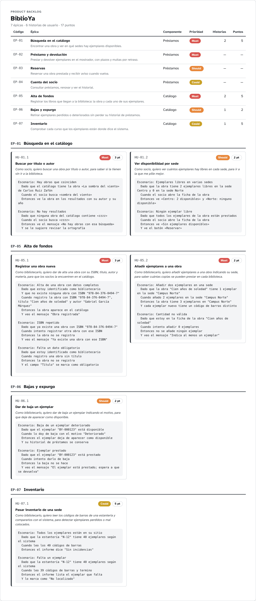
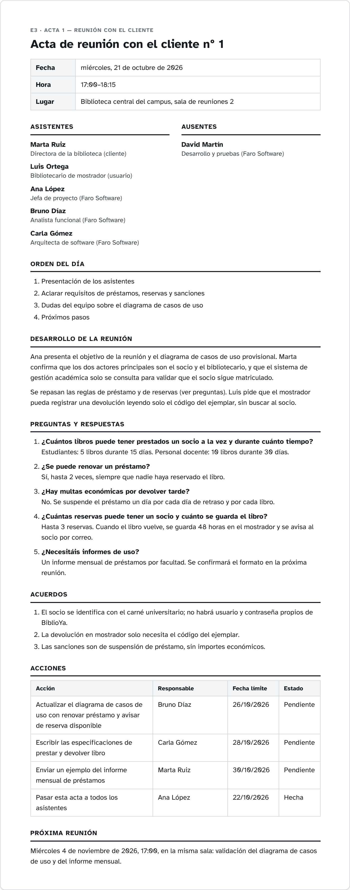

# Ejemplo — BiblioYa — Entrega 3 — Modelo propio, backlog y PUD

_Exportado con se-ramify el 20/10/2026._

## Contenido de la entrega

| Apartado | Peso | Diagramas |
|---|---|---|
| Vuestro propio modelo de desarrollo: nombre, etapas, roles, elementos clave, ventajas e inconvenientes | 30 % | E3 · Modelo de desarrollo Faro; _Descripción, roles, ventajas / inconvenientes y dónde usarlo (texto)_ |
| Backlog completo a nivel de épica, y una épica en historias de usuario | 20 % | E3 · Backlog de producto |
| PUD: Gantt, etapas con sus artefactos, actas e informe | 50 % | E3 · Planificación PUD; E3 · Proceso Unificado — fases y artefactos; E3 · Acta 1 — reunión con el cliente; _Informe con toda la documentación — the memoria this checklist exports, plus your text (texto)_ |

## Índice

1. [E3 · Modelo de desarrollo Faro](#1-e3-modelo-de-desarrollo-faro) — Diagrama de flujo / modelo de proceso
2. [E3 · Backlog de producto](#2-e3-backlog-de-producto) — Backlog de producto (épicas e historias)
3. [E3 · Planificación PUD](#3-e3-planificacion-pud) — Diagrama de Gantt
4. [E3 · Proceso Unificado — fases y artefactos](#4-e3-proceso-unificado-fases-y-artefactos) — Proceso Unificado (fases y artefactos)
5. [E3 · Acta 1 — reunión con el cliente](#5-e3-acta-1-reunion-con-el-cliente) — Acta de reunión

## 1. E3 · Modelo de desarrollo Faro

*Diagrama de flujo / modelo de proceso*


Modelo propio: iteraciones de tres semanas que acaban en una demo al cliente; la especificación (historias y Gherkin) se mantiene al día en cada iteración.

## 2. E3 · Backlog de producto

*Backlog de producto (épicas e historias)*



**Producto:** BiblioYa

7 épicas · 6 historias de usuario · 17 puntos.

### Épicas

| Código | Épica | Componente | Prioridad | Historias | Puntos |
|---|---|---|---|---:|---:|
| EP-01 | Búsqueda en el catálogo | Préstamos | Must | 2 | 5 |
| EP-02 | Préstamo y devolución | Préstamos | Must | 0 | — |
| EP-03 | Reservas | Préstamos | Should | 0 | — |
| EP-04 | Cuenta del socio | Préstamos | Could | 0 | — |
| EP-05 | Alta de fondos | Catálogo | Must | 2 | 5 |
| EP-06 | Bajas y expurgo | Catálogo | Should | 1 | 2 |
| EP-07 | Inventario | Catálogo | Could | 1 | 5 |

### EP-01 · Búsqueda en el catálogo

Componente: Préstamos · Prioridad: Must

Encontrar una obra y ver en qué sedes hay ejemplares disponibles.

#### HU-01.1 · Buscar por título o autor

> Como socio, quiero buscar una obra por título o autor, para saber si la tienen sin ir a la biblioteca.

Prioridad: Must · Puntos: 3

```gherkin
Escenario: Hay obras que coinciden
  Dado que el catálogo tiene la obra «La sombra del viento» de Carlos Ruiz Zafón
  Cuando el socio busca «sombra del viento»
  Entonces ve la obra en los resultados con su autor y su año

Escenario: No hay resultados
  Dado que ninguna obra del catálogo contiene «zzzz»
  Cuando el socio busca «zzzz»
  Entonces ve el mensaje «No hay obras con esa búsqueda»
  Y se le sugiere revisar la ortografía
```

#### HU-01.2 · Ver disponibilidad por sede

> Como socio, quiero ver cuántos ejemplares hay libres en cada sede, para ir a la que me pille mejor.

Prioridad: Should · Puntos: 2

```gherkin
Escenario: Ejemplares libres en varias sedes
  Dado que la obra tiene 2 ejemplares libres en la sede Centro y 0 en la sede Norte
  Cuando el socio abre la ficha de la obra
  Entonces ve «Centro: 2 disponibles» y «Norte: ninguno disponible»

Escenario: Ningún ejemplar libre
  Dado que todos los ejemplares de la obra están prestados
  Cuando el socio abre la ficha de la obra
  Entonces ve «Sin ejemplares disponibles»
  Y ve el botón «Reservar»
```

### EP-02 · Préstamo y devolución

Componente: Préstamos · Prioridad: Must

Prestar y devolver ejemplares en el mostrador, con plazos y multas por retraso.

_Sin desglosar en historias de usuario._

### EP-03 · Reservas

Componente: Préstamos · Prioridad: Should

Reservar una obra prestada y recibir aviso cuando vuelva.

_Sin desglosar en historias de usuario._

### EP-04 · Cuenta del socio

Componente: Préstamos · Prioridad: Could

Consultar préstamos, renovar y ver el historial.

_Sin desglosar en historias de usuario._

### EP-05 · Alta de fondos

Componente: Catálogo · Prioridad: Must

Registrar los libros que llegan a la biblioteca: la obra y cada uno de sus ejemplares.

#### HU-05.1 · Registrar una obra nueva

> Como bibliotecario, quiero dar de alta una obra con su ISBN, título, autor y materia, para que los socios la encuentren en el catálogo.

Prioridad: Must · Puntos: 3

```gherkin
Escenario: Alta de una obra con datos completos
  Dado que estoy identificado como bibliotecario
  Y que no existe ninguna obra con ISBN "978-84-376-0494-7"
  Cuando registro la obra con ISBN "978-84-376-0494-7", título "Cien años de soledad" y autor "Gabriel García Márquez"
  Entonces la obra aparece en el catálogo
  Y veo el mensaje "Obra registrada"

Escenario: ISBN repetido
  Dado que ya existe una obra con ISBN "978-84-376-0494-7"
  Cuando intento registrar otra obra con ese ISBN
  Entonces la obra no se registra
  Y veo el mensaje "Ya existe una obra con ese ISBN"

Escenario: Falta un dato obligatorio
  Dado que estoy identificado como bibliotecario
  Cuando registro una obra sin título
  Entonces la obra no se registra
  Y el campo "Título" se marca como obligatorio
```

#### HU-05.2 · Añadir ejemplares a una obra

> Como bibliotecario, quiero añadir ejemplares a una obra indicando su sede, para saber cuántas copias se pueden prestar en cada biblioteca.

Prioridad: Must · Puntos: 2

```gherkin
Escenario: Añadir dos ejemplares en una sede
  Dado que la obra "Cien años de soledad" tiene 1 ejemplar en la sede "Campus Norte"
  Cuando añado 2 ejemplares en la sede "Campus Norte"
  Entonces la obra tiene 3 ejemplares en "Campus Norte"
  Y cada ejemplar nuevo tiene un código de barras distinto

Escenario: Cantidad no válida
  Dado que estoy en la ficha de la obra "Cien años de soledad"
  Cuando intento añadir 0 ejemplares
  Entonces no se añade ningún ejemplar
  Y veo el mensaje "Indica al menos un ejemplar"
```

### EP-06 · Bajas y expurgo

Componente: Catálogo · Prioridad: Should

Retirar ejemplares perdidos o deteriorados sin perder su historial de préstamos.

#### HU-06.1 · Dar de baja un ejemplar

> Como bibliotecario, quiero dar de baja un ejemplar indicando el motivo, para que deje de aparecer como disponible.

Prioridad: Should · Puntos: 2

```gherkin
Escenario: Baja de un ejemplar deteriorado
  Dado que el ejemplar "BY-000123" está disponible
  Cuando lo doy de baja con el motivo "Deteriorado"
  Entonces el ejemplar deja de aparecer como disponible
  Y su historial de préstamos se conserva

Escenario: Ejemplar prestado
  Dado que el ejemplar "BY-000123" está prestado
  Cuando intento darlo de baja
  Entonces la baja no se hace
  Y veo el mensaje "El ejemplar está prestado; espera a que se devuelva"
```

### EP-07 · Inventario

Componente: Catálogo · Prioridad: Could

Comprobar cada curso que los ejemplares están donde dice el sistema.

#### HU-07.1 · Pasar inventario de una sede

> Como bibliotecario, quiero leer los códigos de barras de una estantería y compararlos con el sistema, para detectar ejemplares perdidos o mal colocados.

Prioridad: Could · Puntos: 5

```gherkin
Escenario: Todos los ejemplares están en su sitio
  Dado que la estantería "N-12" tiene 40 ejemplares según el sistema
  Cuando leo los 40 códigos de barras
  Entonces el informe dice "Sin incidencias"

Escenario: Falta un ejemplar
  Dado que la estantería "N-12" tiene 40 ejemplares según el sistema
  Cuando leo 39 códigos de barras y termino
  Entonces el informe lista el ejemplar que falta
  Y lo marca como "No localizado"
```

## 3. E3 · Planificación PUD

*Diagrama de Gantt*


## 4. E3 · Proceso Unificado — fases y artefactos

*Proceso Unificado (fases y artefactos)*


Artefactos: 16 hechos, 7 en curso y 0 pendientes (23 en total).

### 1. Inicio

**Objetivo:** Decidir con la biblioteca si BiblioYa merece la pena: alcance, visión y coste.

**Hito:** Objetivos del ciclo de vida

**Iteraciones:** I1

| Artefacto | Disciplina | Estado | Diagrama |
|---|---|---|---|
| Visión — Elevator pitch aprobado por la directora de la biblioteca | Modelado del negocio | Hecho | E2 · Visión — elevator pitch |
| Caso de negocio | Modelado del negocio | Hecho | — |
| Lista de riesgos — Riesgo principal: integración con el catálogo actual | Gestión del proyecto | Hecho | — |
| Modelo de casos de uso inicial | Requisitos | Hecho | E2 · Casos de uso |
| Plan del proyecto (Gantt) | Gestión del proyecto | Hecho | E3 · Planificación PUD |
| Glosario — Ejemplar, préstamo, reserva, sanción | Requisitos | En curso | — |

### 2. Elaboración

**Objetivo:** Cerrar los casos de uso de préstamo y reserva y validar la arquitectura con un prototipo.

**Hito:** Arquitectura del ciclo de vida

**Iteraciones:** E1, E2

| Artefacto | Disciplina | Estado | Diagrama |
|---|---|---|---|
| Modelo de casos de uso con especificaciones — CU-01 a CU-06 especificados; faltan los de administración | Requisitos | Hecho | E2 · Casos de uso |
| Modelo del dominio | Modelado del negocio | Hecho | E2 · Diagrama de clases de diseño |
| Modelo de análisis | Análisis y diseño | En curso | — |
| Arquitectura base / descripción de la arquitectura | Análisis y diseño | Hecho | E3 · Despliegue |
| Plan de iteraciones | Gestión del proyecto | Hecho | E3 · Planificación PUD |
| Prototipo — Pantallas de búsqueda y préstamo | Requisitos | Hecho | E3 · Pantallas |

### 3. Construcción

**Objetivo:** Construir préstamos, reservas y avisos en tres iteraciones de dos semanas.

**Hito:** Capacidad operativa inicial

**Iteraciones:** C1, C2, C3

| Artefacto | Disciplina | Estado | Diagrama |
|---|---|---|---|
| Modelo de diseño (clases de diseño) | Análisis y diseño | Hecho | E2 · Diagrama de clases de diseño |
| Diagramas de secuencia — Uno por escenario principal: prestar, devolver, reservar | Análisis y diseño | Hecho | E2 · Secuencia — Reservar libro |
| Modelo de datos (E/R) | Análisis y diseño | Hecho | E3 · Modelo de datos (E/R) |
| Código / componentes | Implementación | En curso | — |
| Plan y casos de prueba | Pruebas | Hecho | E3 · Trazabilidad de requisitos |
| Diagrama de despliegue | Despliegue | Hecho | E3 · Despliegue |

### 4. Transición

**Objetivo:** Poner BiblioYa en marcha en la biblioteca central y formar al personal.

**Hito:** Entrega del producto

**Iteraciones:** T1

| Artefacto | Disciplina | Estado | Diagrama |
|---|---|---|---|
| Plan de despliegue | Despliegue | En curso | — |
| Manual de usuario | Despliegue | En curso | — |
| Formación | Despliegue | En curso | — |
| Versión beta y feedback | Pruebas | En curso | — |
| Acta de cierre / post mortem | Gestión del proyecto | Hecho | Final · Acta post mortem |

### Esfuerzo por disciplina

_De 0 (nada) a 4 (máximo), por fase._

| Disciplina | Inicio | Elaboración | Construcción | Transición |
|---|:-:|:-:|:-:|:-:|
| Modelado del negocio | ●●●○ | ●●○○ | ○○○○ | ○○○○ |
| Requisitos | ●●●○ | ●●●● | ●○○○ | ○○○○ |
| Análisis y diseño | ●○○○ | ●●●● | ●●○○ | ○○○○ |
| Implementación | ○○○○ | ●●○○ | ●●●● | ●○○○ |
| Pruebas | ○○○○ | ●○○○ | ●●●● | ●●○○ |
| Despliegue | ○○○○ | ○○○○ | ●○○○ | ●●●● |
| Gestión de configuración y cambios | ●○○○ | ●○○○ | ●●○○ | ●●○○ |
| Gestión del proyecto | ●●○○ | ●●○○ | ●●○○ | ●●○○ |
| Entorno | ●●○○ | ●●○○ | ●○○○ | ●○○○ |

## 5. E3 · Acta 1 — reunión con el cliente

*Acta de reunión*



**Acta de reunión con el cliente nº 1**

| Fecha | Hora | Lugar |
|---|---|---|
| miércoles, 21 de octubre de 2026 | 17:00–18:15 | Biblioteca central del campus, sala de reuniones 2 |

### Asistentes

- Marta Ruiz — Directora de la biblioteca (cliente)
- Luis Ortega — Bibliotecario de mostrador (usuario)
- Ana López — Jefa de proyecto (Faro Software)
- Bruno Díaz — Analista funcional (Faro Software)
- Carla Gómez — Arquitecta de software (Faro Software)

### Ausentes

- David Martín — Desarrollo y pruebas (Faro Software)

### Orden del día

1. Presentación de los asistentes
2. Aclarar requisitos de préstamos, reservas y sanciones
3. Dudas del equipo sobre el diagrama de casos de uso
4. Próximos pasos

### Desarrollo de la reunión

Ana presenta el objetivo de la reunión y el diagrama de casos de uso provisional. Marta confirma que los dos actores principales son el socio y el bibliotecario, y que el sistema de gestión académica solo se consulta para validar que el socio sigue matriculado.

Se repasan las reglas de préstamo y de reservas (ver preguntas). Luis pide que el mostrador pueda registrar una devolución leyendo solo el código del ejemplar, sin buscar al socio.

### Preguntas y respuestas

1. **¿Cuántos libros puede tener prestados un socio a la vez y durante cuánto tiempo?**
   Estudiantes: 5 libros durante 15 días. Personal docente: 10 libros durante 30 días.
2. **¿Se puede renovar un préstamo?**
   Sí, hasta 2 veces, siempre que nadie haya reservado el libro.
3. **¿Hay multas económicas por devolver tarde?**
   No. Se suspende el préstamo un día por cada día de retraso y por cada libro.
4. **¿Cuántas reservas puede tener un socio y cuánto se guarda el libro?**
   Hasta 3 reservas. Cuando el libro vuelve, se guarda 48 horas en el mostrador y se avisa al socio por correo.
5. **¿Necesitáis informes de uso?**
   Un informe mensual de préstamos por facultad. Se confirmará el formato en la próxima reunión.

### Acuerdos

1. El socio se identifica con el carné universitario; no habrá usuario y contraseña propios de BiblioYa.
2. La devolución en mostrador solo necesita el código del ejemplar.
3. Las sanciones son de suspensión de préstamo, sin importes económicos.

### Acciones

| Acción | Responsable | Fecha límite | Estado |
|---|---|---|---|
| Actualizar el diagrama de casos de uso con renovar préstamo y avisar de reserva disponible | Bruno Díaz | 26/10/2026 | Pendiente |
| Escribir las especificaciones de prestar y devolver libro | Carla Gómez | 28/10/2026 | Pendiente |
| Enviar un ejemplo del informe mensual de préstamos | Marta Ruiz | 30/10/2026 | Pendiente |
| Pasar esta acta a todos los asistentes | Ana López | 22/10/2026 | Hecha |

### Próxima reunión

Miércoles 4 de noviembre de 2026, 17:00, en la misma sala: validación del diagrama de casos de uso y del informe mensual.
