# Ejemplo — BiblioYa — Entrega final

_Exportado con se-ramify el 20/10/2026._

## Contenido de la entrega

| Apartado | Peso | Diagramas |
|---|---|---|
| Definición de la empresa: nombre, marca, modelo de negocio y roles | 25 % | E1 · Modelo de negocio — Faro Software; E1 · Organigrama y roles; _Nombre y marca (logo, lema) (texto)_ |
| Descripción completa de las dos alternativas, con su arquitectura | 25 % | E1 · Arquitectura — local; E1 · Arquitectura — nube |
| TCO a 3 años con costes completos y realistas de cada alternativa | 25 % | E1 · TCO a 3 años |
| Recomendación razonada de la alternativa más adecuada | 25 % | E1 · TCO a 3 años |
| Todos los diagramas UML: casos de uso con especificaciones, clases y secuencia | 60 % | E2 · Casos de uso; E2 · Diagrama de clases de diseño; E2 · Secuencia — Reservar libro |
| Mapa de stakeholders (uno de los dos formatos, mínimo seis) | 20 % | E2 · Mapa de stakeholders |
| Visión del proyecto según el modelo del "elevator pitch" | 20 % | E2 · Visión — elevator pitch |
| Vuestro propio modelo de desarrollo: nombre, etapas, roles, elementos clave, ventajas e inconvenientes | 30 % | E3 · Modelo de desarrollo Faro; _Descripción, roles, ventajas / inconvenientes y dónde usarlo (texto)_ |
| Backlog completo a nivel de épica, y una épica en historias de usuario | 20 % | E3 · Backlog de producto |
| PUD: Gantt, etapas con sus artefactos, actas e informe | 50 % | E3 · Planificación PUD; E3 · Proceso Unificado — fases y artefactos; E3 · Acta 1 — reunión con el cliente; _Informe con toda la documentación — the memoria this checklist exports, plus your text (texto)_ |
| Elementos previos corregidos | 30 % | _E1, E2 and E3 complete — see their tabs (texto)_ |
| Acta post mortem: qué ha funcionado y qué mejoraríais (equipo y PUD) | 10 % | Final · Acta post mortem |
| Informe "¿y con metodología ágil?" y su acta (bien / mal / mejorable) | 20 % | Final · Acta — ¿y con metodología ágil?; _Informe: qué habría cambiado con una metodología ágil (texto)_ |
| User Story Mapping de los dos primeros sprints | 10 % | Final · User Story Mapping — sprints 1 y 2 |
| Todas las épicas del componente en historias con Gherkin, y el material para generar y probar la app con IA | 30 % | E3 · Backlog de producto |

## Índice

1. [E1 · Modelo de negocio — Faro Software](#1-e1-modelo-de-negocio-faro-software) — Lienzo de modelo de negocio
2. [E1 · Organigrama y roles](#2-e1-organigrama-y-roles) — Organigrama y roles
3. [E1 · Arquitectura — local](#3-e1-arquitectura-local) — Diagrama de arquitectura / equipos
4. [E1 · Arquitectura — nube](#4-e1-arquitectura-nube) — Diagrama de arquitectura / equipos
5. [E1 · TCO a 3 años](#5-e1-tco-a-3-anos) — TCO (coste total de propiedad)
6. [E2 · Casos de uso](#6-e2-casos-de-uso) — Diagrama de sistema / casos de uso
7. [E2 · Diagrama de clases de diseño](#7-e2-diagrama-de-clases-de-diseno) — Diagrama de clases
8. [E2 · Secuencia — Reservar libro](#8-e2-secuencia-reservar-libro) — Diagrama de secuencia
9. [E2 · Mapa de stakeholders](#9-e2-mapa-de-stakeholders) — Mapa de stakeholders
10. [E2 · Visión — elevator pitch](#10-e2-vision-elevator-pitch) — Visión — elevator pitch
11. [E3 · Modelo de desarrollo Faro](#11-e3-modelo-de-desarrollo-faro) — Diagrama de flujo / modelo de proceso
12. [E3 · Backlog de producto](#12-e3-backlog-de-producto) — Backlog de producto (épicas e historias)
13. [E3 · Planificación PUD](#13-e3-planificacion-pud) — Diagrama de Gantt
14. [E3 · Proceso Unificado — fases y artefactos](#14-e3-proceso-unificado-fases-y-artefactos) — Proceso Unificado (fases y artefactos)
15. [E3 · Acta 1 — reunión con el cliente](#15-e3-acta-1-reunion-con-el-cliente) — Acta de reunión
16. [Final · Acta post mortem](#16-final-acta-post-mortem) — Acta de reunión
17. [Final · Acta — ¿y con metodología ágil?](#17-final-acta-y-con-metodologia-agil) — Acta de reunión
18. [Final · User Story Mapping — sprints 1 y 2](#18-final-user-story-mapping-sprints-1-y-2) — User Story Mapping

## 1. E1 · Modelo de negocio — Faro Software

*Lienzo de modelo de negocio*


Faro Software es una empresa inventada de cuatro personas. Este lienzo describe la empresa, no el producto.

**Negocio:** Faro Software — software a medida para instituciones educativas y culturales

### Socios clave

- Proveedor de nube (alojamiento)
- Universidades con las que ya trabajamos
- Freelance de diseño UX

### Actividades clave

- Análisis de requisitos con el cliente
- Desarrollo y pruebas
- Mantenimiento y soporte

### Recursos clave

- Equipo de 4 ingenieros
- Plantillas y componentes reutilizables
- Experiencia en el sector educativo

### Propuesta de valor

- Aplicaciones a medida entregadas por iteraciones cortas
- El cliente ve una versión que funciona cada 3 semanas
- Documentación formal para poder mantenerla

### Relación con clientes

- Reunión con el cliente al final de cada iteración
- Un único interlocutor (jefa de proyecto)

### Canales

- Recomendación entre universidades
- Concursos públicos
- Web y LinkedIn

### Segmentos de clientes

- Bibliotecas y servicios universitarios
- Museos y archivos pequeños

### Estructura de costes

- Salarios (≈80 %)
- Licencias y nube para desarrollo
- Formación

### Fuentes de ingresos

- Proyecto a precio cerrado por fases
- Contrato anual de mantenimiento (15 % del proyecto)
- Bolsa de horas para cambios

### Notas

Faro Software es una empresa inventada de cuatro personas. Este lienzo describe la empresa, no el producto.

## 2. E1 · Organigrama y roles

*Organigrama y roles*

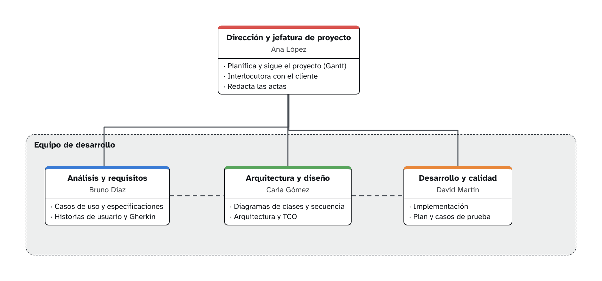

| Rol | Persona | Área | Depende de | Responsabilidades |
|---|---|---|---|---|
| Dirección y jefatura de proyecto | Ana López |  | — | Planifica y sigue el proyecto (Gantt)<br>Interlocutora con el cliente<br>Redacta las actas |
| Análisis y requisitos | Bruno Díaz | Equipo de desarrollo | Dirección y jefatura de proyecto | Casos de uso y especificaciones<br>Historias de usuario y Gherkin |
| Arquitectura y diseño | Carla Gómez | Equipo de desarrollo | Dirección y jefatura de proyecto | Diagramas de clases y secuencia<br>Arquitectura y TCO |
| Desarrollo y calidad | David Martín | Equipo de desarrollo | Dirección y jefatura de proyecto | Implementación<br>Plan y casos de prueba |

## 3. E1 · Arquitectura — local

*Diagrama de arquitectura / equipos*

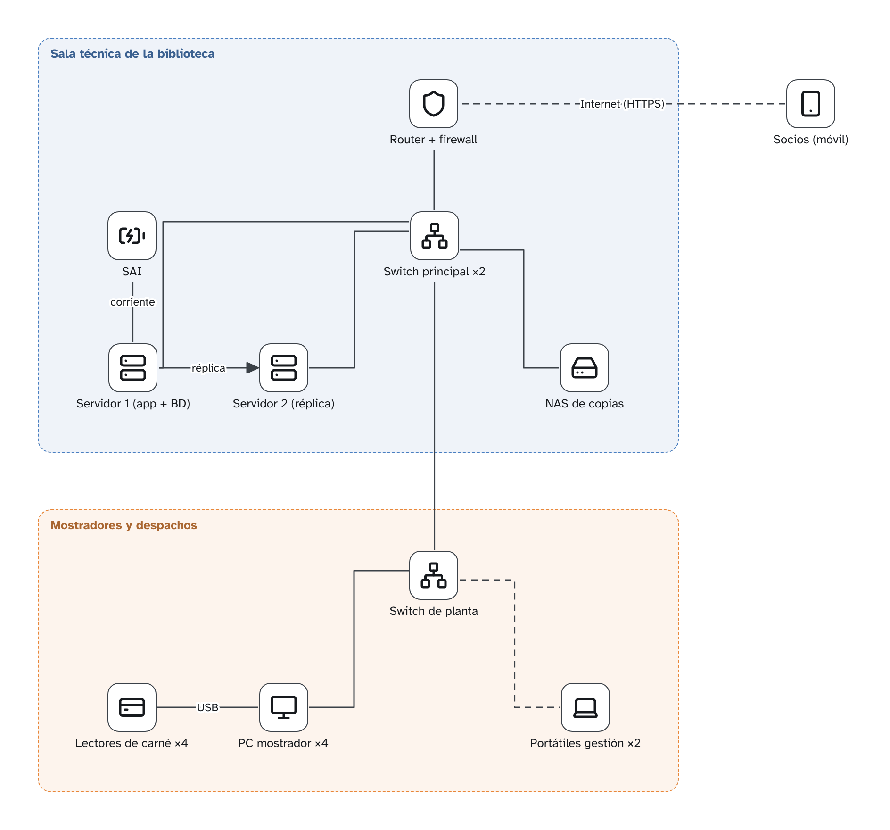

Alternativa A. Todo duplicado donde una avería pararía el servicio: dos servidores con réplica, dos switches, SAI y copias en NAS.

### Sala técnica de la biblioteca

| Equipo | Tipo |
|---|---|
| Router + firewall | Cortafuegos |
| SAI | SAI |
| Switch principal ×2 | Switch |
| Servidor 1 (app + BD) | Servidor |
| Servidor 2 (réplica) | Servidor |
| NAS de copias | NAS / copias |

### Mostradores y despachos

| Equipo | Tipo |
|---|---|
| Switch de planta | Switch |
| Lectores de carné ×4 | TPV |
| PC mostrador ×4 | PC de sobremesa |
| Portátiles gestión ×2 | Portátil |

### Fuera de zonas

| Equipo | Tipo |
|---|---|
| Socios (móvil) | Móvil |

### Conexiones

- Router + firewall → Switch principal ×2
- SAI → Servidor 1 (app + BD) (corriente)
- Switch principal ×2 → Servidor 1 (app + BD)
- Switch principal ×2 → Servidor 2 (réplica)
- Switch principal ×2 → NAS de copias
- Servidor 1 (app + BD) → Servidor 2 (réplica) (réplica)
- Switch principal ×2 → Switch de planta
- Switch de planta → PC mostrador ×4
- Switch de planta → Portátiles gestión ×2
- Lectores de carné ×4 → PC mostrador ×4 (USB)
- Socios (móvil) → Router + firewall (Internet (HTTPS))

## 4. E1 · Arquitectura — nube

*Diagrama de arquitectura / equipos*

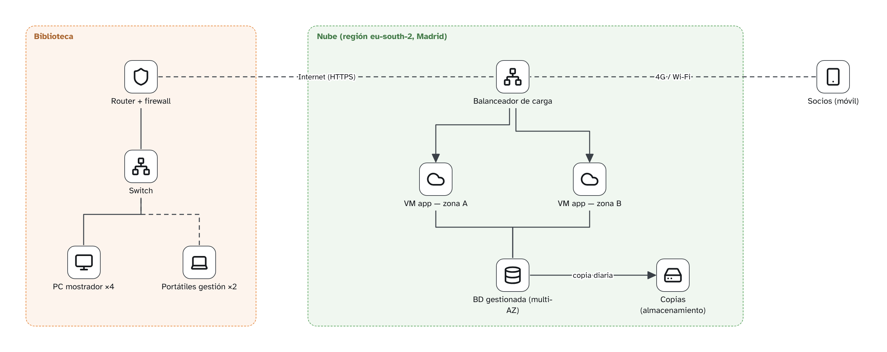

Alternativa B. La aplicación en dos zonas de disponibilidad detrás de un balanceador, con base de datos gestionada multi-AZ.

### Biblioteca

| Equipo | Tipo |
|---|---|
| Router + firewall | Cortafuegos |
| Switch | Switch |
| PC mostrador ×4 | PC de sobremesa |
| Portátiles gestión ×2 | Portátil |

### Nube (región eu-south-2, Madrid)

| Equipo | Tipo |
|---|---|
| Balanceador de carga | Switch |
| VM app — zona A | Servicio en la nube |
| VM app — zona B | Servicio en la nube |
| BD gestionada (multi-AZ) | Base de datos |
| Copias (almacenamiento) | NAS / copias |

### Fuera de zonas

| Equipo | Tipo |
|---|---|
| Socios (móvil) | Móvil |

### Conexiones

- Router + firewall → Balanceador de carga (Internet (HTTPS))
- Switch → Router + firewall
- PC mostrador ×4 → Switch
- Portátiles gestión ×2 → Switch
- Balanceador de carga → VM app — zona A
- Balanceador de carga → VM app — zona B
- VM app — zona A → BD gestionada (multi-AZ)
- VM app — zona B → BD gestionada (multi-AZ)
- BD gestionada (multi-AZ) → Copias (almacenamiento) (copia diaria)
- Socios (móvil) → Balanceador de carga (4G / Wi-Fi)

## 5. E1 · TCO a 3 años

*TCO (coste total de propiedad)*


_Coste total de propiedad a 3 años, sin inflación ni tasa de descuento. Importes en euros._

### Local (on-premises)

Dos servidores en la sala técnica de la biblioteca central: uno principal y otro de réplica en espera (la base de datos se replica en tiempo real). SAI para cortes de luz, NAS con copias diarias y una copia semanal fuera del edificio. Un cortafuegos y un switch gestionable conectan con los puestos de las cinco bibliotecas.

| Bloque | Concepto | Tipo | Pago | Año 1 | Año 2 | Año 3 | Total | Fuente |
|---|---|---|---|---:|---:|---:|---:|---|
| Desarrollo | Análisis, desarrollo y pruebas (horas del equipo, 35 €/h) (×1200) | CAPEX | Una vez (año 1) | 42.000 € | 0 € | 0 € | **42.000 €** | ejemplo — horas estimadas × coste/hora |
| Desarrollo | Instalación, configuración y migración de datos | CAPEX | Una vez (año 1) | 3.200 € | 0 € | 0 € | **3.200 €** | ejemplo — sustituir por precio real |
| Desarrollo | Formación del personal de las bibliotecas | CAPEX | Una vez (año 1) | 1.200 € | 0 € | 0 € | **1.200 €** | ejemplo — sustituir por precio real |
| HW y SW | Servidor Dell PowerEdge T150 (Xeon E-2314, 32 GB, 2× SSD 960 GB) (×2) | CAPEX | Una vez (año 1) | 3.300 € | 0 € | 0 € | **3.300 €** | ejemplo — sustituir por precio real |
| HW y SW | SAI APC Smart-UPS 1500 VA | CAPEX | Una vez (año 1) | 780 € | 0 € | 0 € | **780 €** | ejemplo — sustituir por precio real |
| HW y SW | NAS Synology DS923+ | CAPEX | Una vez (año 1) | 620 € | 0 € | 0 € | **620 €** | ejemplo — sustituir por precio real |
| HW y SW | Discos para el NAS (4 TB) (×4) | CAPEX | Una vez (año 1) | 480 € | 0 € | 0 € | **480 €** | ejemplo — sustituir por precio real |
| HW y SW | Switch gestionable 24 puertos | CAPEX | Una vez (año 1) | 280 € | 0 € | 0 € | **280 €** | ejemplo — sustituir por precio real |
| HW y SW | Cortafuegos FortiGate 40F | CAPEX | Una vez (año 1) | 650 € | 0 € | 0 € | **650 €** | ejemplo — sustituir por precio real |
| HW y SW | Armario rack 12U | CAPEX | Una vez (año 1) | 350 € | 0 € | 0 € | **350 €** | ejemplo — sustituir por precio real |
| HW y SW | Windows Server 2025 Standard (16 núcleos) (×2) | CAPEX | Una vez (año 1) | 2.300 € | 0 € | 0 € | **2.300 €** | ejemplo — sustituir por precio real |
| HW y SW | Ampliación de garantía del fabricante (×2) | OPEX | Al año desde el año 2 | 0 € | 380 € | 380 € | **760 €** | ejemplo — sustituir por precio real |
| Operaciones | Administrador de sistemas (20 % de 38.000 €/año) | OPEX | Al año | 7.600 € | 7.600 € | 7.600 € | **22.800 €** | ejemplo — tabla salarial |
| Operaciones | Copia externa en la nube (2 TB) | OPEX | Al mes | 300 € | 300 € | 300 € | **900 €** | ejemplo — sustituir por precio real |
| Operaciones | Mantenimiento correctivo y parches (40 h/año) | OPEX | Al año | 1.400 € | 1.400 € | 1.400 € | **4.200 €** | ejemplo — sustituir por precio real |
| Largo plazo | Reemplazo de discos del NAS (×4) | CAPEX | Una vez (año 3) | 0 € | 0 € | 480 € | **480 €** | ejemplo — sustituir por precio real |
| | **Total** | | | **64.460 €** | **9.680 €** | **10.160 €** | **84.300 €** | |

### Nube (AWS, región España)

La aplicación corre en dos máquinas virtuales en dos zonas de disponibilidad detrás de un balanceador; la base de datos es PostgreSQL gestionado con réplica en otra zona. Copias automáticas diarias. Las bibliotecas se conectan por Internet (HTTPS) y la sede, además, por VPN.

| Bloque | Concepto | Tipo | Pago | Año 1 | Año 2 | Año 3 | Total | Fuente |
|---|---|---|---|---:|---:|---:|---:|---|
| Desarrollo | Análisis, desarrollo y pruebas (horas del equipo, 35 €/h) (×1200) | CAPEX | Una vez (año 1) | 42.000 € | 0 € | 0 € | **42.000 €** | ejemplo — horas estimadas × coste/hora |
| Desarrollo | Migración de datos y puesta en marcha en la nube | CAPEX | Una vez (año 1) | 2.400 € | 0 € | 0 € | **2.400 €** | ejemplo — sustituir por precio real |
| Desarrollo | Formación del personal de las bibliotecas | CAPEX | Una vez (año 1) | 1.200 € | 0 € | 0 € | **1.200 €** | ejemplo — sustituir por precio real |
| HW y SW | Máquinas virtuales EC2 t3.medium (una por zona) (×2) | OPEX | Al mes | 840 € | 840 € | 840 € | **2.520 €** | ejemplo — calculadora de AWS |
| HW y SW | Base de datos RDS PostgreSQL db.t3.medium multi-AZ | OPEX | Al mes | 1.680 € | 1.680 € | 1.680 € | **5.040 €** | ejemplo — calculadora de AWS |
| HW y SW | Balanceador de carga (ALB) | OPEX | Al mes | 264 € | 264 € | 264 € | **792 €** | ejemplo — calculadora de AWS |
| HW y SW | Almacenamiento de copias (S3, 300 GB) | OPEX | Al mes | 96 € | 96 € | 96 € | **288 €** | ejemplo — calculadora de AWS |
| HW y SW | Tráfico de salida | OPEX | Al mes | 60 € | 60 € | 60 € | **180 €** | ejemplo — calculadora de AWS |
| HW y SW | VPN sitio a sitio con la biblioteca central | OPEX | Al mes | 432 € | 432 € | 432 € | **1.296 €** | ejemplo — calculadora de AWS |
| Operaciones | Plan de soporte Business | OPEX | Al mes | 1.200 € | 1.200 € | 1.200 € | **3.600 €** | ejemplo — web del proveedor |
| Operaciones | Administrador cloud (10 % de 40.000 €/año) | OPEX | Al año | 4.000 € | 4.000 € | 4.000 € | **12.000 €** | ejemplo — tabla salarial |
| Operaciones | Monitorización y alertas | OPEX | Al mes | 120 € | 120 € | 120 € | **360 €** | ejemplo — calculadora de AWS |
| Largo plazo | Crecimiento de uso (más socios y préstamos) | OPEX | Al año desde el año 2 | 0 € | 300 € | 300 € | **600 €** | ejemplo — sustituir por precio real |
| Largo plazo | Plan de salida: exportar datos si se cambia de proveedor | CAPEX | Una vez (año 3) | 0 € | 0 € | 800 € | **800 €** | ejemplo — sustituir por precio real |
| | **Total** | | | **54.292 €** | **8.992 €** | **9.792 €** | **73.076 €** | |

### Resumen

| Alternativa | Año 1 | Año 2 | Año 3 | Total 3 años | CAPEX | OPEX | Por usuario |
|---|---:|---:|---:|---:|---:|---:|---:|
| Local (on-premises) | 64.460 € | 9.680 € | 10.160 € | **84.300 €** | 55.640 € | 28.660 € | 2.810,00 € |
| Nube (AWS, región España) | 54.292 € | 8.992 € | 9.792 € | **73.076 €** | 46.400 € | 26.676 € | 2.435,87 € |

| Bloque | Local (on-premises) | Nube (AWS, región España) |
|---|---:|---:|
| Desarrollo y despliegue | 46.400 € | 45.600 € |
| Hardware y software | 9.520 € | 10.116 € |
| Operaciones | 27.900 € | 15.960 € |
| Gastos a largo plazo | 480 € | 1.400 € |

La alternativa más barata a 3 años es **Nube (AWS, región España)** (73.076 €), 11.224 € menos que Local (on-premises).

Calculado para 30 usuarios.

### Comparación cualitativa

_Puntuación de 1 (peor) a 5 (mejor), ponderada por el peso de cada criterio._

| Criterio | Peso | Local (on-premises) | Nube (AWS, región España) |
|---|---:|---:|---:|
| Disponibilidad (9–18 h, L–V) | 30 % | 3 | 5 |
| Redundancia | 30 % | 3 | 5 |
| Riesgo operativo | 20 % | 2 | 4 |
| Escalabilidad | 10 % | 2 | 5 |
| Dependencia del proveedor | 10 % | 5 | 2 |
| **Puntuación ponderada** | | **2,90** | **4,50** |

### Recomendación

Recomendamos la alternativa en la nube. A tres años sale unos 11.000 € más barata, sobre todo porque no hay que comprar servidores ni dedicar tanto tiempo de administración, y cumple mejor los requisitos de la biblioteca: si cae una máquina o una zona, la otra sigue atendiendo, y el proveedor garantiza la disponibilidad en horario de apertura sin depender de una sala técnica que se calienta. Su punto débil es la dependencia del proveedor; por eso incluimos un plan de salida (exportar los datos en formato abierto) y usamos PostgreSQL, que se puede llevar a otro proveedor o a local. Si la biblioteca no tuviera buena conexión a Internet, la alternativa local volvería a ser razonable.

## 6. E2 · Casos de uso

*Diagrama de sistema / casos de uso*

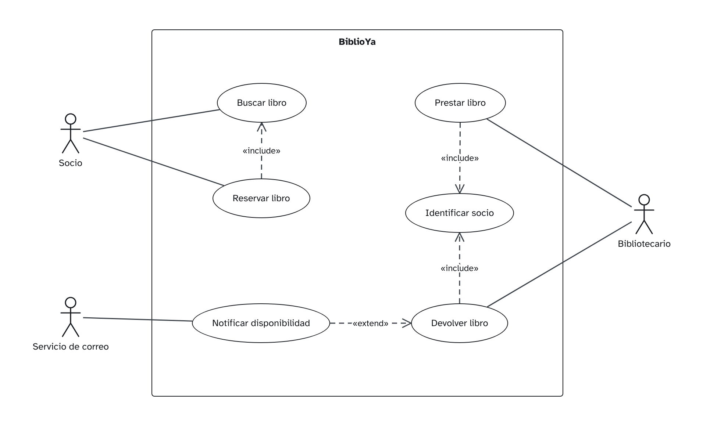

### CU-01 Buscar libro

| Campo | Contenido |
|---|---|
| Código | CU-01 |
| Nombre | Buscar libro |
| Actor principal | Socio |
| Actores secundarios |  |
| Descripción | El socio busca libros del catálogo por título, autor o ISBN y ve si hay ejemplares disponibles. |
| Disparador | El socio escribe en el buscador. |
| Precondiciones | Ninguna (la búsqueda es pública). |
| Flujo principal | 1. El socio escribe un título, autor o ISBN.<br>2. El sistema muestra los libros que coinciden, con el número de ejemplares disponibles.<br>3. El socio abre la ficha de un libro.<br>4. El sistema muestra sus ejemplares y su estado. |
| Flujos alternativos | 2a. No hay resultados: el sistema lo indica y sugiere revisar la ortografía. |
| Postcondiciones | Ninguna (no cambia datos). |
| Prioridad | Alta |
| Frecuencia | Cientos de veces al día |

### CU-02 Reservar libro

| Campo | Contenido |
|---|---|
| Código | CU-02 |
| Nombre | Reservar libro |
| Actor principal | Socio |
| Actores secundarios |  |
| Descripción | El socio reserva un libro que ahora está prestado para recogerlo cuando se devuelva. |
| Disparador | El socio pulsa «Reservar» en la ficha de un libro. |
| Precondiciones | El socio ha iniciado sesión y no tiene sanciones. |
| Flujo principal | 1. El socio busca el libro (CU-01).<br>2. El sistema muestra la ficha con sus ejemplares.<br>3. El socio pulsa «Reservar».<br>4. El sistema registra la reserva y muestra la posición en la cola. |
| Flujos alternativos | 3a. Hay un ejemplar disponible: el sistema ofrece reservarlo para recoger hoy.<br>4a. El socio ya tiene 3 reservas: el sistema lo impide y lo avisa. |
| Postcondiciones | La reserva queda registrada y el socio recibirá un aviso al devolverse el libro. |
| Prioridad | Media |
| Frecuencia | Unas 20 veces al día |

### CU-03 Prestar libro

| Campo | Contenido |
|---|---|
| Código | CU-03 |
| Nombre | Prestar libro |
| Actor principal | Bibliotecario |
| Actores secundarios | Socio |
| Descripción | El bibliotecario presta un ejemplar a un socio en el mostrador. |
| Disparador | Un socio entrega un libro en el mostrador para llevárselo. |
| Precondiciones | El bibliotecario ha iniciado sesión. |
| Flujo principal | 1. El bibliotecario identifica al socio (CU-04).<br>2. El bibliotecario lee el código del ejemplar.<br>3. El sistema comprueba que el socio puede pedir y el ejemplar está disponible.<br>4. El sistema registra el préstamo con fecha de devolución a 15 días.<br>5. El sistema imprime o envía el comprobante. |
| Flujos alternativos | 3a. El socio tiene una sanción o ya tiene 5 préstamos: el sistema lo impide y muestra el motivo.<br>3b. El ejemplar está reservado por otro socio: el sistema lo indica y no lo presta. |
| Postcondiciones | El ejemplar queda prestado al socio con su fecha de devolución. |
| Prioridad | Alta |
| Frecuencia | Unas 150 veces al día |

### CU-04 Identificar socio

| Campo | Contenido |
|---|---|
| Código | CU-04 |
| Nombre | Identificar socio |
| Actor principal | Bibliotecario |
| Actores secundarios |  |
| Descripción | El sistema reconoce al socio por su carné para operar en su nombre. |
| Disparador | El bibliotecario pasa el carné por el lector. |
| Precondiciones | El socio tiene carné en vigor. |
| Flujo principal | 1. El bibliotecario pasa el carné por el lector.<br>2. El sistema muestra los datos del socio, sus préstamos y sus sanciones. |
| Flujos alternativos | 1a. El carné no se lee: el bibliotecario escribe el número de socio.<br>2a. El carné está caducado: el sistema lo indica. |
| Postcondiciones | El socio queda identificado en el mostrador. |
| Prioridad | Alta |
| Frecuencia | Cada préstamo y devolución |

### CU-05 Devolver libro

| Campo | Contenido |
|---|---|
| Código | CU-05 |
| Nombre | Devolver libro |
| Actor principal | Bibliotecario |
| Actores secundarios | Socio |
| Descripción | El bibliotecario registra la devolución de un ejemplar y, si hay reservas, avisa al siguiente socio. |
| Disparador | Un socio devuelve un libro en el mostrador. |
| Precondiciones | El ejemplar está prestado. |
| Flujo principal | 1. El bibliotecario lee el código del ejemplar.<br>2. El sistema cierra el préstamo con la fecha de hoy.<br>3. El sistema comprueba si hay retraso.<br>4. El sistema marca el ejemplar como disponible. |
| Flujos alternativos | 3a. Hay retraso: el sistema calcula la sanción (1 día sin préstamo por día de retraso) y la muestra.<br>4a. Hay una reserva: el sistema lo marca como reservado y avisa al socio (CU-06). |
| Postcondiciones | El préstamo queda cerrado y el ejemplar disponible o reservado. |
| Prioridad | Alta |
| Frecuencia | Unas 150 veces al día |

### CU-06 Notificar disponibilidad

| Campo | Contenido |
|---|---|
| Código | CU-06 |
| Nombre | Notificar disponibilidad |
| Actor principal | Servicio de correo |
| Actores secundarios |  |
| Descripción | El sistema avisa al socio de que el libro que reservó ya está disponible. |
| Disparador | Se devuelve un ejemplar con reservas (CU-05). |
| Precondiciones | Hay una reserva y el libro se acaba de devolver. |
| Flujo principal | 1. El sistema toma la reserva más antigua.<br>2. El sistema envía un correo al socio con el plazo para recogerlo (3 días). |
| Flujos alternativos | 2a. El correo falla: el sistema lo reintenta en una hora y lo anota. |
| Postcondiciones | El socio está avisado y el ejemplar apartado para él. |
| Prioridad | Media |
| Frecuencia | Unas 20 veces al día |

## 7. E2 · Diagrama de clases de diseño

*Diagrama de clases*


## 8. E2 · Secuencia — Reservar libro

*Diagrama de secuencia*

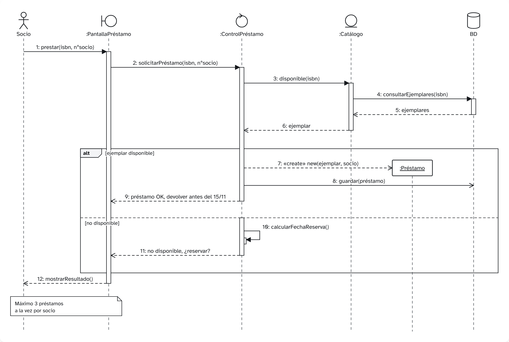

## 9. E2 · Mapa de stakeholders

*Mapa de stakeholders*


**Producto / proyecto:** App de préstamos

| Stakeholder | Rol | Poder/Influencia | Interés | Estrategia | Anillo | Sector | Actitud | Notas |
|---|---|---|---|---|---|---|---|---|
| Dirección de la biblioteca | Cliente: encarga y paga el proyecto | 90 % | 85 % | Gestionar de cerca | Es vital involucrarlo | Decisores | A favor | Aprueba el alcance y el presupuesto. |
| Vicerrectorado | Financia la biblioteca | 82 % | 30 % | Mantener satisfechos | Es necesario involucrarlos | Decisores | Neutral | Solo interviene si cambia el presupuesto. |
| Bibliotecarios | Usuarios internos diarios | 45 % | 90 % | Mantener informados | Es vital involucrarlo | Clientes | En contra | Temen más trabajo durante la migración. |
| Estudiantes | Usuarios finales | 30 % | 80 % | Mantener informados | Es necesario involucrarlos | Clientes | A favor |  |
| Profesores | Recomiendan bibliografía | 35 % | 55 % | Mantener informados | Estaría bien involucrarlos | Clientes | Neutral |  |
| Servicio de informática | Mantiene servidores y la red | 70 % | 60 % | Gestionar de cerca | Es necesario involucrarlos | Proveedores | Neutral | Necesitamos su visto bueno para integrar el catálogo. |
| Proveedor del catálogo | Licencia del software actual (OPAC) | 60 % | 25 % | Mantener satisfechos | Estaría bien involucrarlos | Proveedores | En contra | Puede cobrar por abrir su API. |
| Delegado de protección de datos | RGPD | 75 % | 30 % | Mantener satisfechos | Estaría bien involucrarlos | Influyentes | Neutral |  |
| Consejo de estudiantes | Representa a los alumnos | 25 % | 45 % | Monitorizar | Informar por cortesía | Influyentes | A favor |  |
| Otras bibliotecas de la red | Préstamo interbibliotecario | 15 % | 20 % | Monitorizar | Informar por cortesía | Proveedores | Neutral |  |

### Por estrategia (matriz poder/influencia – interés)

- **Gestionar de cerca** (Champions · Drivers): Dirección de la biblioteca, Servicio de informática
- **Mantener satisfechos** (Context setters · Blockers): Vicerrectorado, Proveedor del catálogo, Delegado de protección de datos
- **Mantener informados** (Defenders · Subjects): Bibliotecarios, Estudiantes, Profesores
- **Monitorizar** (Crowd · Bystanders): Consejo de estudiantes, Otras bibliotecas de la red

## 10. E2 · Visión — elevator pitch

*Visión — elevator pitch*


> Para los socios de las bibliotecas municipales que quieren saber si un libro está disponible y llevárselo sin colas, BiblioYa es un servicio web y móvil de préstamos que permite buscar, reservar y renovar préstamos en dos clics. A diferencia del catálogo en línea actual, que solo informa, nuestro producto avisa cuando el libro vuelve, gestiona la cola de reservas y recuerda las devoluciones.

| Plantilla | Contenido |
|---|---|
| Para (cliente objetivo) | los socios de las bibliotecas municipales |
| Que (necesidad u oportunidad) | quieren saber si un libro está disponible y llevárselo sin colas |
| Producto (nombre) | BiblioYa |
| Es (categoría, con su artículo) | un servicio web y móvil de préstamos |
| Que (beneficio clave, razón para comprarlo) | permite buscar, reservar y renovar préstamos en dos clics |
| A diferencia de (alternativa / competidor) | el catálogo en línea actual, que solo informa |
| Nuestro producto (diferenciador) | avisa cuando el libro vuelve, gestiona la cola de reservas y recuerda las devoluciones |

## 11. E3 · Modelo de desarrollo Faro

*Diagrama de flujo / modelo de proceso*

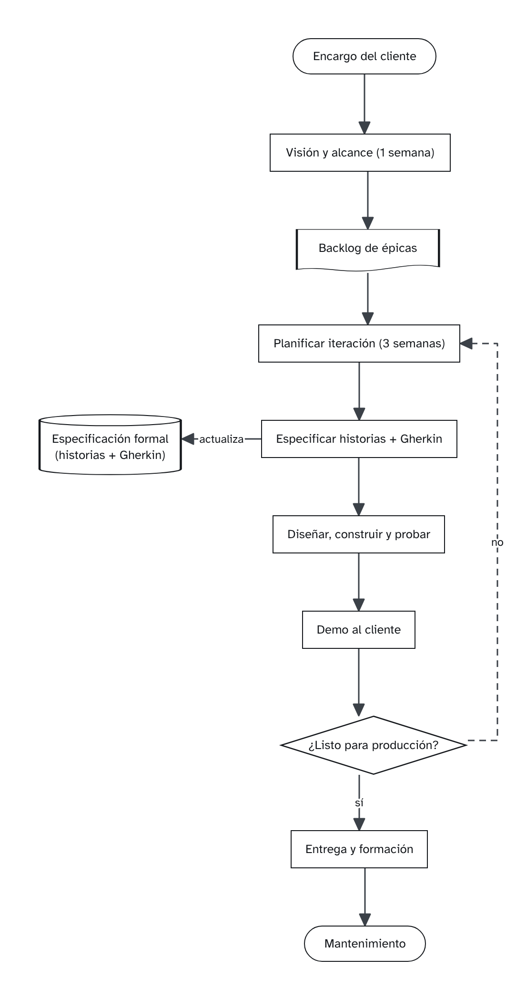

Modelo propio: iteraciones de tres semanas que acaban en una demo al cliente; la especificación (historias y Gherkin) se mantiene al día en cada iteración.

## 12. E3 · Backlog de producto

*Backlog de producto (épicas e historias)*


**Producto:** BiblioYa

7 épicas · 6 historias de usuario · 17 puntos.

### Épicas

| Código | Épica | Componente | Prioridad | Historias | Puntos |
|---|---|---|---|---:|---:|
| EP-01 | Búsqueda en el catálogo | Préstamos | Must | 2 | 5 |
| EP-02 | Préstamo y devolución | Préstamos | Must | 0 | — |
| EP-03 | Reservas | Préstamos | Should | 0 | — |
| EP-04 | Cuenta del socio | Préstamos | Could | 0 | — |
| EP-05 | Alta de fondos | Catálogo | Must | 2 | 5 |
| EP-06 | Bajas y expurgo | Catálogo | Should | 1 | 2 |
| EP-07 | Inventario | Catálogo | Could | 1 | 5 |

### EP-01 · Búsqueda en el catálogo

Componente: Préstamos · Prioridad: Must

Encontrar una obra y ver en qué sedes hay ejemplares disponibles.

#### HU-01.1 · Buscar por título o autor

> Como socio, quiero buscar una obra por título o autor, para saber si la tienen sin ir a la biblioteca.

Prioridad: Must · Puntos: 3

```gherkin
Escenario: Hay obras que coinciden
  Dado que el catálogo tiene la obra «La sombra del viento» de Carlos Ruiz Zafón
  Cuando el socio busca «sombra del viento»
  Entonces ve la obra en los resultados con su autor y su año

Escenario: No hay resultados
  Dado que ninguna obra del catálogo contiene «zzzz»
  Cuando el socio busca «zzzz»
  Entonces ve el mensaje «No hay obras con esa búsqueda»
  Y se le sugiere revisar la ortografía
```

#### HU-01.2 · Ver disponibilidad por sede

> Como socio, quiero ver cuántos ejemplares hay libres en cada sede, para ir a la que me pille mejor.

Prioridad: Should · Puntos: 2

```gherkin
Escenario: Ejemplares libres en varias sedes
  Dado que la obra tiene 2 ejemplares libres en la sede Centro y 0 en la sede Norte
  Cuando el socio abre la ficha de la obra
  Entonces ve «Centro: 2 disponibles» y «Norte: ninguno disponible»

Escenario: Ningún ejemplar libre
  Dado que todos los ejemplares de la obra están prestados
  Cuando el socio abre la ficha de la obra
  Entonces ve «Sin ejemplares disponibles»
  Y ve el botón «Reservar»
```

### EP-02 · Préstamo y devolución

Componente: Préstamos · Prioridad: Must

Prestar y devolver ejemplares en el mostrador, con plazos y multas por retraso.

_Sin desglosar en historias de usuario._

### EP-03 · Reservas

Componente: Préstamos · Prioridad: Should

Reservar una obra prestada y recibir aviso cuando vuelva.

_Sin desglosar en historias de usuario._

### EP-04 · Cuenta del socio

Componente: Préstamos · Prioridad: Could

Consultar préstamos, renovar y ver el historial.

_Sin desglosar en historias de usuario._

### EP-05 · Alta de fondos

Componente: Catálogo · Prioridad: Must

Registrar los libros que llegan a la biblioteca: la obra y cada uno de sus ejemplares.

#### HU-05.1 · Registrar una obra nueva

> Como bibliotecario, quiero dar de alta una obra con su ISBN, título, autor y materia, para que los socios la encuentren en el catálogo.

Prioridad: Must · Puntos: 3

```gherkin
Escenario: Alta de una obra con datos completos
  Dado que estoy identificado como bibliotecario
  Y que no existe ninguna obra con ISBN "978-84-376-0494-7"
  Cuando registro la obra con ISBN "978-84-376-0494-7", título "Cien años de soledad" y autor "Gabriel García Márquez"
  Entonces la obra aparece en el catálogo
  Y veo el mensaje "Obra registrada"

Escenario: ISBN repetido
  Dado que ya existe una obra con ISBN "978-84-376-0494-7"
  Cuando intento registrar otra obra con ese ISBN
  Entonces la obra no se registra
  Y veo el mensaje "Ya existe una obra con ese ISBN"

Escenario: Falta un dato obligatorio
  Dado que estoy identificado como bibliotecario
  Cuando registro una obra sin título
  Entonces la obra no se registra
  Y el campo "Título" se marca como obligatorio
```

#### HU-05.2 · Añadir ejemplares a una obra

> Como bibliotecario, quiero añadir ejemplares a una obra indicando su sede, para saber cuántas copias se pueden prestar en cada biblioteca.

Prioridad: Must · Puntos: 2

```gherkin
Escenario: Añadir dos ejemplares en una sede
  Dado que la obra "Cien años de soledad" tiene 1 ejemplar en la sede "Campus Norte"
  Cuando añado 2 ejemplares en la sede "Campus Norte"
  Entonces la obra tiene 3 ejemplares en "Campus Norte"
  Y cada ejemplar nuevo tiene un código de barras distinto

Escenario: Cantidad no válida
  Dado que estoy en la ficha de la obra "Cien años de soledad"
  Cuando intento añadir 0 ejemplares
  Entonces no se añade ningún ejemplar
  Y veo el mensaje "Indica al menos un ejemplar"
```

### EP-06 · Bajas y expurgo

Componente: Catálogo · Prioridad: Should

Retirar ejemplares perdidos o deteriorados sin perder su historial de préstamos.

#### HU-06.1 · Dar de baja un ejemplar

> Como bibliotecario, quiero dar de baja un ejemplar indicando el motivo, para que deje de aparecer como disponible.

Prioridad: Should · Puntos: 2

```gherkin
Escenario: Baja de un ejemplar deteriorado
  Dado que el ejemplar "BY-000123" está disponible
  Cuando lo doy de baja con el motivo "Deteriorado"
  Entonces el ejemplar deja de aparecer como disponible
  Y su historial de préstamos se conserva

Escenario: Ejemplar prestado
  Dado que el ejemplar "BY-000123" está prestado
  Cuando intento darlo de baja
  Entonces la baja no se hace
  Y veo el mensaje "El ejemplar está prestado; espera a que se devuelva"
```

### EP-07 · Inventario

Componente: Catálogo · Prioridad: Could

Comprobar cada curso que los ejemplares están donde dice el sistema.

#### HU-07.1 · Pasar inventario de una sede

> Como bibliotecario, quiero leer los códigos de barras de una estantería y compararlos con el sistema, para detectar ejemplares perdidos o mal colocados.

Prioridad: Could · Puntos: 5

```gherkin
Escenario: Todos los ejemplares están en su sitio
  Dado que la estantería "N-12" tiene 40 ejemplares según el sistema
  Cuando leo los 40 códigos de barras
  Entonces el informe dice "Sin incidencias"

Escenario: Falta un ejemplar
  Dado que la estantería "N-12" tiene 40 ejemplares según el sistema
  Cuando leo 39 códigos de barras y termino
  Entonces el informe lista el ejemplar que falta
  Y lo marca como "No localizado"
```

## 13. E3 · Planificación PUD

*Diagrama de Gantt*

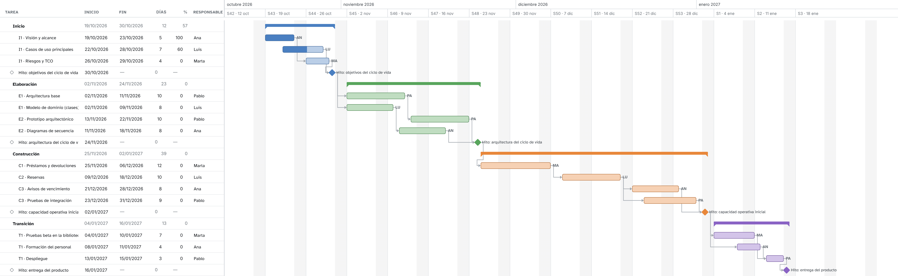

## 14. E3 · Proceso Unificado — fases y artefactos

*Proceso Unificado (fases y artefactos)*

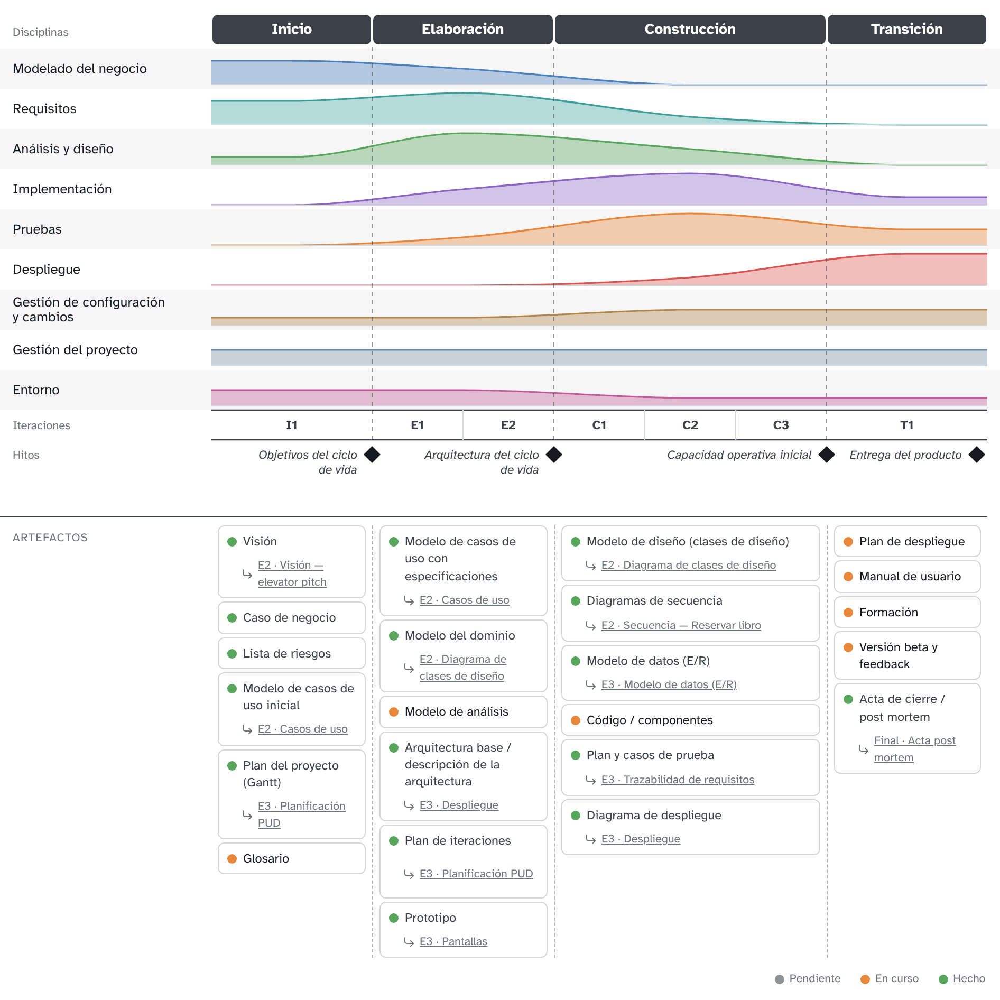

Artefactos: 16 hechos, 7 en curso y 0 pendientes (23 en total).

### 1. Inicio

**Objetivo:** Decidir con la biblioteca si BiblioYa merece la pena: alcance, visión y coste.

**Hito:** Objetivos del ciclo de vida

**Iteraciones:** I1

| Artefacto | Disciplina | Estado | Diagrama |
|---|---|---|---|
| Visión — Elevator pitch aprobado por la directora de la biblioteca | Modelado del negocio | Hecho | E2 · Visión — elevator pitch |
| Caso de negocio | Modelado del negocio | Hecho | — |
| Lista de riesgos — Riesgo principal: integración con el catálogo actual | Gestión del proyecto | Hecho | — |
| Modelo de casos de uso inicial | Requisitos | Hecho | E2 · Casos de uso |
| Plan del proyecto (Gantt) | Gestión del proyecto | Hecho | E3 · Planificación PUD |
| Glosario — Ejemplar, préstamo, reserva, sanción | Requisitos | En curso | — |

### 2. Elaboración

**Objetivo:** Cerrar los casos de uso de préstamo y reserva y validar la arquitectura con un prototipo.

**Hito:** Arquitectura del ciclo de vida

**Iteraciones:** E1, E2

| Artefacto | Disciplina | Estado | Diagrama |
|---|---|---|---|
| Modelo de casos de uso con especificaciones — CU-01 a CU-06 especificados; faltan los de administración | Requisitos | Hecho | E2 · Casos de uso |
| Modelo del dominio | Modelado del negocio | Hecho | E2 · Diagrama de clases de diseño |
| Modelo de análisis | Análisis y diseño | En curso | — |
| Arquitectura base / descripción de la arquitectura | Análisis y diseño | Hecho | E3 · Despliegue |
| Plan de iteraciones | Gestión del proyecto | Hecho | E3 · Planificación PUD |
| Prototipo — Pantallas de búsqueda y préstamo | Requisitos | Hecho | E3 · Pantallas |

### 3. Construcción

**Objetivo:** Construir préstamos, reservas y avisos en tres iteraciones de dos semanas.

**Hito:** Capacidad operativa inicial

**Iteraciones:** C1, C2, C3

| Artefacto | Disciplina | Estado | Diagrama |
|---|---|---|---|
| Modelo de diseño (clases de diseño) | Análisis y diseño | Hecho | E2 · Diagrama de clases de diseño |
| Diagramas de secuencia — Uno por escenario principal: prestar, devolver, reservar | Análisis y diseño | Hecho | E2 · Secuencia — Reservar libro |
| Modelo de datos (E/R) | Análisis y diseño | Hecho | E3 · Modelo de datos (E/R) |
| Código / componentes | Implementación | En curso | — |
| Plan y casos de prueba | Pruebas | Hecho | E3 · Trazabilidad de requisitos |
| Diagrama de despliegue | Despliegue | Hecho | E3 · Despliegue |

### 4. Transición

**Objetivo:** Poner BiblioYa en marcha en la biblioteca central y formar al personal.

**Hito:** Entrega del producto

**Iteraciones:** T1

| Artefacto | Disciplina | Estado | Diagrama |
|---|---|---|---|
| Plan de despliegue | Despliegue | En curso | — |
| Manual de usuario | Despliegue | En curso | — |
| Formación | Despliegue | En curso | — |
| Versión beta y feedback | Pruebas | En curso | — |
| Acta de cierre / post mortem | Gestión del proyecto | Hecho | Final · Acta post mortem |

### Esfuerzo por disciplina

_De 0 (nada) a 4 (máximo), por fase._

| Disciplina | Inicio | Elaboración | Construcción | Transición |
|---|:-:|:-:|:-:|:-:|
| Modelado del negocio | ●●●○ | ●●○○ | ○○○○ | ○○○○ |
| Requisitos | ●●●○ | ●●●● | ●○○○ | ○○○○ |
| Análisis y diseño | ●○○○ | ●●●● | ●●○○ | ○○○○ |
| Implementación | ○○○○ | ●●○○ | ●●●● | ●○○○ |
| Pruebas | ○○○○ | ●○○○ | ●●●● | ●●○○ |
| Despliegue | ○○○○ | ○○○○ | ●○○○ | ●●●● |
| Gestión de configuración y cambios | ●○○○ | ●○○○ | ●●○○ | ●●○○ |
| Gestión del proyecto | ●●○○ | ●●○○ | ●●○○ | ●●○○ |
| Entorno | ●●○○ | ●●○○ | ●○○○ | ●○○○ |

## 15. E3 · Acta 1 — reunión con el cliente

*Acta de reunión*


**Acta de reunión con el cliente nº 1**

| Fecha | Hora | Lugar |
|---|---|---|
| miércoles, 21 de octubre de 2026 | 17:00–18:15 | Biblioteca central del campus, sala de reuniones 2 |

### Asistentes

- Marta Ruiz — Directora de la biblioteca (cliente)
- Luis Ortega — Bibliotecario de mostrador (usuario)
- Ana López — Jefa de proyecto (Faro Software)
- Bruno Díaz — Analista funcional (Faro Software)
- Carla Gómez — Arquitecta de software (Faro Software)

### Ausentes

- David Martín — Desarrollo y pruebas (Faro Software)

### Orden del día

1. Presentación de los asistentes
2. Aclarar requisitos de préstamos, reservas y sanciones
3. Dudas del equipo sobre el diagrama de casos de uso
4. Próximos pasos

### Desarrollo de la reunión

Ana presenta el objetivo de la reunión y el diagrama de casos de uso provisional. Marta confirma que los dos actores principales son el socio y el bibliotecario, y que el sistema de gestión académica solo se consulta para validar que el socio sigue matriculado.

Se repasan las reglas de préstamo y de reservas (ver preguntas). Luis pide que el mostrador pueda registrar una devolución leyendo solo el código del ejemplar, sin buscar al socio.

### Preguntas y respuestas

1. **¿Cuántos libros puede tener prestados un socio a la vez y durante cuánto tiempo?**
   Estudiantes: 5 libros durante 15 días. Personal docente: 10 libros durante 30 días.
2. **¿Se puede renovar un préstamo?**
   Sí, hasta 2 veces, siempre que nadie haya reservado el libro.
3. **¿Hay multas económicas por devolver tarde?**
   No. Se suspende el préstamo un día por cada día de retraso y por cada libro.
4. **¿Cuántas reservas puede tener un socio y cuánto se guarda el libro?**
   Hasta 3 reservas. Cuando el libro vuelve, se guarda 48 horas en el mostrador y se avisa al socio por correo.
5. **¿Necesitáis informes de uso?**
   Un informe mensual de préstamos por facultad. Se confirmará el formato en la próxima reunión.

### Acuerdos

1. El socio se identifica con el carné universitario; no habrá usuario y contraseña propios de BiblioYa.
2. La devolución en mostrador solo necesita el código del ejemplar.
3. Las sanciones son de suspensión de préstamo, sin importes económicos.

### Acciones

| Acción | Responsable | Fecha límite | Estado |
|---|---|---|---|
| Actualizar el diagrama de casos de uso con renovar préstamo y avisar de reserva disponible | Bruno Díaz | 26/10/2026 | Pendiente |
| Escribir las especificaciones de prestar y devolver libro | Carla Gómez | 28/10/2026 | Pendiente |
| Enviar un ejemplo del informe mensual de préstamos | Marta Ruiz | 30/10/2026 | Pendiente |
| Pasar esta acta a todos los asistentes | Ana López | 22/10/2026 | Hecha |

### Próxima reunión

Miércoles 4 de noviembre de 2026, 17:00, en la misma sala: validación del diagrama de casos de uso y del informe mensual.

## 16. Final · Acta post mortem

*Acta de reunión*

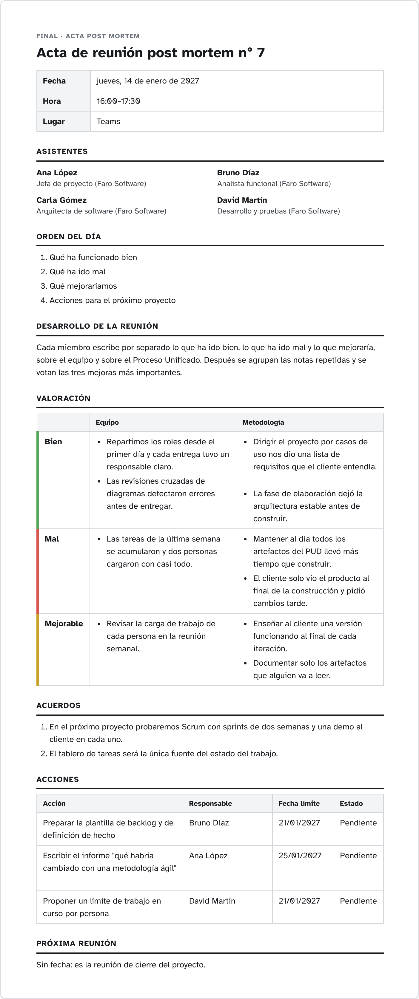

**Acta de reunión post mortem nº 7**

| Fecha | Hora | Lugar |
|---|---|---|
| jueves, 14 de enero de 2027 | 16:00–17:30 | Teams |

### Asistentes

- Ana López — Jefa de proyecto (Faro Software)
- Bruno Díaz — Analista funcional (Faro Software)
- Carla Gómez — Arquitecta de software (Faro Software)
- David Martín — Desarrollo y pruebas (Faro Software)

### Orden del día

1. Qué ha funcionado bien
2. Qué ha ido mal
3. Qué mejoraríamos
4. Acciones para el próximo proyecto

### Desarrollo de la reunión

Cada miembro escribe por separado lo que ha ido bien, lo que ha ido mal y lo que mejoraría, sobre el equipo y sobre el Proceso Unificado. Después se agrupan las notas repetidas y se votan las tres mejoras más importantes.

### Valoración

#### Equipo

**Bien**

- Repartimos los roles desde el primer día y cada entrega tuvo un responsable claro.
- Las revisiones cruzadas de diagramas detectaron errores antes de entregar.

**Mal**

- Las tareas de la última semana se acumularon y dos personas cargaron con casi todo.

**Mejorable**

- Revisar la carga de trabajo de cada persona en la reunión semanal.

#### Metodología

**Bien**

- Dirigir el proyecto por casos de uso nos dio una lista de requisitos que el cliente entendía.
- La fase de elaboración dejó la arquitectura estable antes de construir.

**Mal**

- Mantener al día todos los artefactos del PUD llevó más tiempo que construir.
- El cliente solo vio el producto al final de la construcción y pidió cambios tarde.

**Mejorable**

- Enseñar al cliente una versión funcionando al final de cada iteración.
- Documentar solo los artefactos que alguien va a leer.

### Acuerdos

1. En el próximo proyecto probaremos Scrum con sprints de dos semanas y una demo al cliente en cada uno.
2. El tablero de tareas será la única fuente del estado del trabajo.

### Acciones

| Acción | Responsable | Fecha límite | Estado |
|---|---|---|---|
| Preparar la plantilla de backlog y de definición de hecho | Bruno Díaz | 21/01/2027 | Pendiente |
| Escribir el informe "qué habría cambiado con una metodología ágil" | Ana López | 25/01/2027 | Pendiente |
| Proponer un límite de trabajo en curso por persona | David Martín | 21/01/2027 | Pendiente |

### Próxima reunión

Sin fecha: es la reunión de cierre del proyecto.

## 17. Final · Acta — ¿y con metodología ágil?

*Acta de reunión*

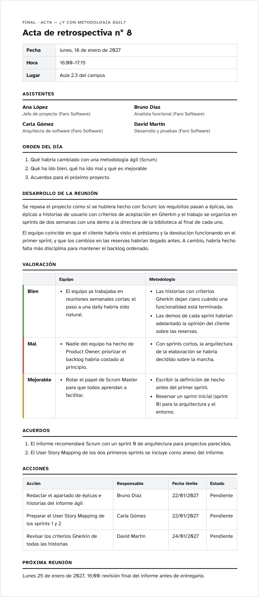

**Acta de retrospectiva nº 8**

| Fecha | Hora | Lugar |
|---|---|---|
| lunes, 18 de enero de 2027 | 16:00–17:15 | Aula 2.3 del campus |

### Asistentes

- Ana López — Jefa de proyecto (Faro Software)
- Bruno Díaz — Analista funcional (Faro Software)
- Carla Gómez — Arquitecta de software (Faro Software)
- David Martín — Desarrollo y pruebas (Faro Software)

### Orden del día

1. Qué habría cambiado con una metodología ágil (Scrum)
2. Qué ha ido bien, qué ha ido mal y qué es mejorable
3. Acuerdos para el próximo proyecto

### Desarrollo de la reunión

Se repasa el proyecto como si se hubiera hecho con Scrum: los requisitos pasan a épicas, las épicas a historias de usuario con criterios de aceptación en Gherkin y el trabajo se organiza en sprints de dos semanas con una demo a la directora de la biblioteca al final de cada uno.

El equipo coincide en que el cliente habría visto el préstamo y la devolución funcionando en el primer sprint, y que los cambios en las reservas habrían llegado antes. A cambio, habría hecho falta más disciplina para mantener el backlog ordenado.

### Valoración

#### Equipo

**Bien**

- El equipo ya trabajaba en reuniones semanales cortas; el paso a una daily habría sido natural.

**Mal**

- Nadie del equipo ha hecho de Product Owner; priorizar el backlog habría costado al principio.

**Mejorable**

- Rotar el papel de Scrum Master para que todos aprendan a facilitar.

#### Metodología

**Bien**

- Las historias con criterios Gherkin dejan claro cuándo una funcionalidad está terminada.
- Las demos de cada sprint habrían adelantado la opinión del cliente sobre las reservas.

**Mal**

- Con sprints cortos, la arquitectura de la elaboración se habría decidido sobre la marcha.

**Mejorable**

- Escribir la definición de hecho antes del primer sprint.
- Reservar un sprint inicial (sprint 0) para la arquitectura y el entorno.

### Acuerdos

1. El informe recomendará Scrum con un sprint 0 de arquitectura para proyectos parecidos.
2. El User Story Mapping de los dos primeros sprints se incluye como anexo del informe.

### Acciones

| Acción | Responsable | Fecha límite | Estado |
|---|---|---|---|
| Redactar el apartado de épicas e historias del informe ágil | Bruno Díaz | 22/01/2027 | Pendiente |
| Preparar el User Story Mapping de los sprints 1 y 2 | Carla Gómez | 22/01/2027 | Pendiente |
| Revisar los criterios Gherkin de todas las historias | David Martín | 24/01/2027 | Pendiente |

### Próxima reunión

Lunes 25 de enero de 2027, 16:00: revisión final del informe antes de entregarlo.

## 18. Final · User Story Mapping — sprints 1 y 2

*User Story Mapping*

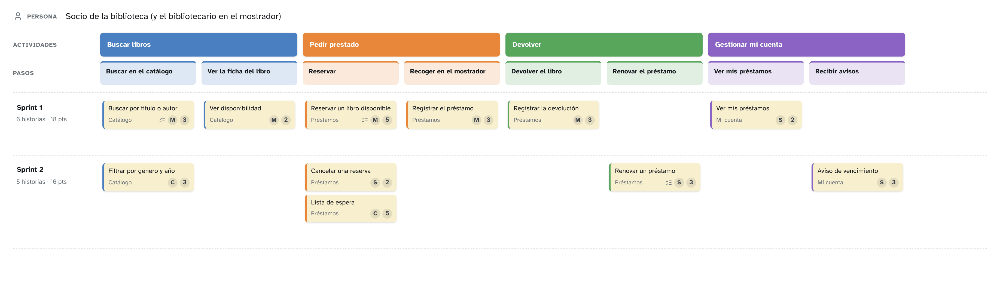

**Persona:** Socio de la biblioteca (y el bibliotecario en el mostrador)

### Backbone

- **Buscar libros**
  - Buscar en el catálogo
  - Ver la ficha del libro
- **Pedir prestado**
  - Reservar
  - Recoger en el mostrador
- **Devolver**
  - Devolver el libro
  - Renovar el préstamo
- **Gestionar mi cuenta**
  - Ver mis préstamos
  - Recibir avisos

### Sprint 1 (18 pts)

#### Buscar libros › Buscar en el catálogo

##### Buscar por título o autor

> Como socio, quiero buscar un libro por título o autor, para saber si la biblioteca lo tiene.

Épica: Catálogo · Prioridad: Must · Puntos: 3

```gherkin
Escenario: Buscar un libro que existe
  Dado que el catálogo tiene "Cien años de soledad"
  Cuando busco "cien años"
  Entonces veo "Cien años de soledad" en los resultados

Escenario: Buscar un libro que no existe
  Dado que el catálogo no tiene ningún libro de "Zzz"
  Cuando busco "Zzz"
  Entonces veo el mensaje "No hay resultados"
```

#### Buscar libros › Ver la ficha del libro

##### Ver disponibilidad

> Como socio, quiero ver cuántos ejemplares quedan libres, para decidir si lo reservo.

Épica: Catálogo · Prioridad: Must · Puntos: 2

#### Pedir prestado › Reservar

##### Reservar un libro disponible

> Como socio, quiero reservar un ejemplar disponible, para recogerlo en las próximas 48 horas.

Épica: Préstamos · Prioridad: Must · Puntos: 5

```gherkin
Escenario: Reservar un ejemplar libre
  Dado que hay 2 ejemplares disponibles de "Rayuela"
  Cuando reservo "Rayuela"
  Entonces quedan 1 ejemplares disponibles
  Y recibo un aviso con el plazo de recogida
```

#### Pedir prestado › Recoger en el mostrador

##### Registrar el préstamo

> Como bibliotecario, quiero registrar el préstamo al entregar el libro, para que conste quién lo tiene y hasta cuándo.

Épica: Préstamos · Prioridad: Must · Puntos: 3

#### Devolver › Devolver el libro

##### Registrar la devolución

> Como bibliotecario, quiero registrar una devolución escaneando el libro, para que el ejemplar vuelva a estar disponible.

Épica: Préstamos · Prioridad: Must · Puntos: 3

#### Gestionar mi cuenta › Ver mis préstamos

##### Ver mis préstamos

> Como socio, quiero ver los libros que tengo y su fecha de devolución, para no pasarme del plazo.

Épica: Mi cuenta · Prioridad: Should · Puntos: 2

### Sprint 2 (16 pts)

#### Buscar libros › Buscar en el catálogo

##### Filtrar por género y año

> Como socio, quiero filtrar los resultados por género y año, para encontrar lecturas parecidas.

Épica: Catálogo · Prioridad: Could · Puntos: 3

#### Pedir prestado › Reservar

##### Cancelar una reserva

> Como socio, quiero cancelar una reserva, para liberar el ejemplar para otro socio.

Épica: Préstamos · Prioridad: Should · Puntos: 2

##### Lista de espera

> Como socio, quiero apuntarme a la lista de espera de un libro prestado, para que me avisen cuando vuelva.

Épica: Préstamos · Prioridad: Could · Puntos: 5

#### Devolver › Renovar el préstamo

##### Renovar un préstamo

> Como socio, quiero renovar un préstamo una vez, para terminar el libro sin multa.

Épica: Préstamos · Prioridad: Should · Puntos: 3

```gherkin
Escenario: Renovar un préstamo sin reservas pendientes
  Dado que tengo "Rayuela" prestado y nadie lo ha reservado
  Cuando pido renovarlo
  Entonces la fecha de devolución se amplía 14 días
```

#### Gestionar mi cuenta › Recibir avisos

##### Aviso de vencimiento

> Como socio, quiero recibir un aviso dos días antes del vencimiento, para devolver a tiempo.

Épica: Mi cuenta · Prioridad: Should · Puntos: 3
